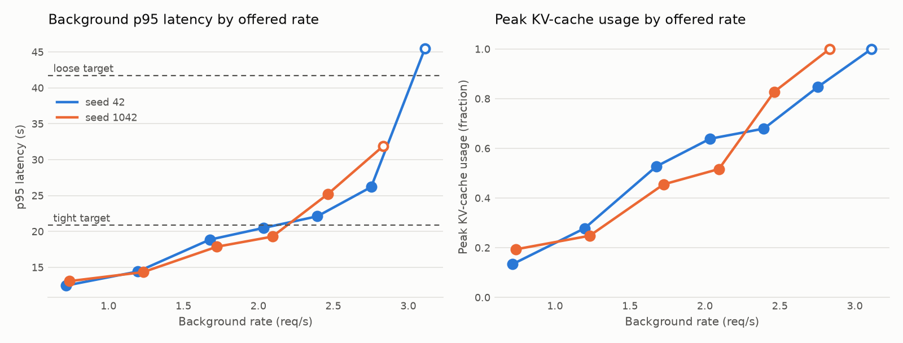
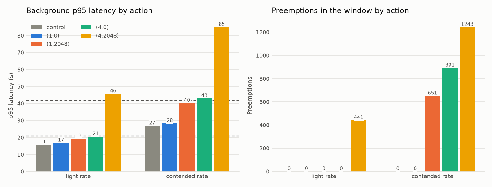
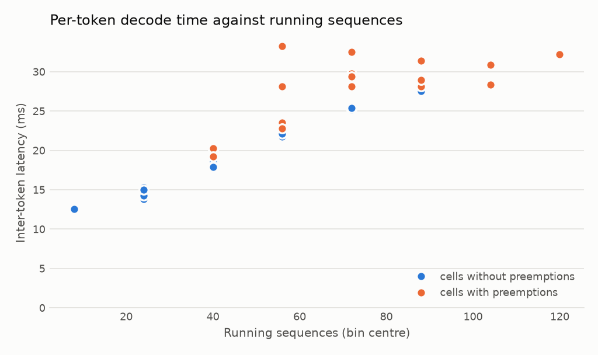
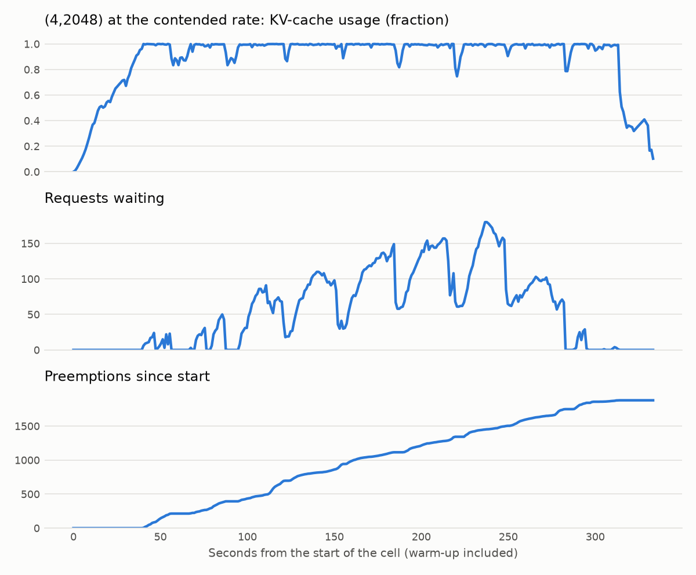
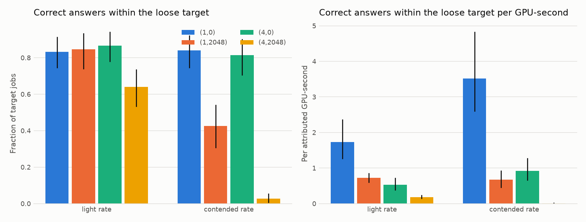

# Mid-point baseline on the RTX 4080 laptop, 2026-11-15

Hardware: HP Omen laptop, RTX 4080 Laptop GPU (12 GB), WSL2, vLLM 0.32.0, Qwen3-1.7B BF16. Results from other machines must not be pooled with these.

Generated by `16_make_baseline_report.py` from the logged run directories listed in `sources.json`. Every number below is formatted from a logged value; none is typed by hand.

## What was measured

- **Sustained calibration:** background-only synthetic traffic (reference-budget lengths, `ignore_eos`) over a rate ladder; idle latency, per-rung completion, latency, queue and KV-cache usage; frozen light and contended rates.
- **Profiling pass:** a background-only control and each action at the two frozen rates on one matched synthetic trace per rate; server gauges, counters and histograms, GPU samples, and client timing of streamed target requests.
- **Matched real-answer comparison:** real, graded answers to a fixed question cohort for each fixed action, next to matched synthetic background traffic at the two frozen rates.

## What was not measured

- No router or controller. Every action is fixed for a whole cell, so nothing here is a routing gain.
- Calibration and profiling use replayed lengths and score no answers.
- One machine and one server configuration. One pass per calibration rung and per profiling cell.
- Failures are kept in every denominator and listed by status; nothing was dropped.

## Figures

Sustained calibration: background p95 and peak KV-cache usage against offered rate. Hollow markers are rungs classed unstable.

Profiling pass: background p95 (dashed lines: latency targets) and preemptions for each action at the two frozen rates.

Profiling pass: per-cell median inter-token latency for each bin of 16 running sequences (bins with at least 10 one-second intervals).

Profiling pass, (4,2048) at the contended rate: KV-cache usage, waiting requests and preemptions over time.

Matched real-answer comparison: correct answers within the loose latency target, as a fraction of target jobs and per attributed GPU-second. Black lines: 95% bootstrap intervals over questions.

## Tables

### Calibration seed 42

Source `/root/hpml-final-project/evaluation-results/sustained-calibration-4080-20261115-seed42`, commit `25d6f83`, status `complete`. Idle p95 10.43 s; latency targets 20.85 s and 41.70 s; frozen light rate 1.197 req/s, contended rate 2.753 req/s.

| Rate (req/s) | Requests | Completed | p50 (s) | p95 (s) | p95 / idle | Running mean / max | Waiting mean / max | KV cache mean / max | Backlog growth | Tokens/s | Stable | Role |
|---|---|---|---|---|---|---|---|---|---|---|---|---|
| 0.718 | 109 | 109 | 11.6 | 12.5 | 1.20 | 6.8 / 11 | 0.0 / 0 | 0.08 / 0.13 | -0.013 | 602 | yes |  |
| 1.197 | 209 | 209 | 13.1 | 14.4 | 1.38 | 14.8 / 23 | 0.0 / 0 | 0.16 / 0.28 | +0.004 | 1148 | yes | light |
| 1.676 | 320 | 320 | 16.3 | 18.8 | 1.81 | 29.4 / 44 | 0.0 / 0 | 0.32 / 0.53 | +0.012 | 1809 | yes |  |
| 2.035 | 369 | 369 | 17.5 | 20.5 | 1.97 | 37.1 / 54 | 0.0 / 0 | 0.40 / 0.64 | -0.016 | 2106 | yes |  |
| 2.394 | 424 | 424 | 20.1 | 22.1 | 2.12 | 45.7 / 62 | 0.0 / 0 | 0.49 / 0.68 | +0.033 | 2358 | yes |  |
| 2.753 | 491 | 491 | 23.4 | 26.2 | 2.51 | 61.8 / 78 | 0.0 / 0 | 0.66 / 0.85 | +0.030 | 2700 | yes | contended |
| 3.112 | 553 | 553 | 32.7 | 45.5 | 4.36 | 86.9 / 116 | 9.0 / 78 | 0.92 / 1.00 | +0.077 | 2927 | no |  |

### Calibration seed 1042

Source `/root/hpml-final-project/evaluation-results/sustained-calibration-4080-20261115-seed1042`, commit `25d6f83`, status `complete`. Idle p95 10.46 s; latency targets 20.92 s and 41.84 s; frozen light rate 1.231 req/s, contended rate 2.463 req/s.

| Rate (req/s) | Requests | Completed | p50 (s) | p95 (s) | p95 / idle | Running mean / max | Waiting mean / max | KV cache mean / max | Backlog growth | Tokens/s | Stable | Role |
|---|---|---|---|---|---|---|---|---|---|---|---|---|
| 0.739 | 137 | 137 | 12.2 | 13.1 | 1.25 | 9.3 / 17 | 0.0 / 0 | 0.10 / 0.19 | -0.006 | 785 | yes |  |
| 1.231 | 204 | 204 | 13.0 | 14.3 | 1.37 | 14.6 / 23 | 0.0 / 0 | 0.16 / 0.25 | +0.008 | 1133 | yes | light |
| 1.724 | 312 | 312 | 16.1 | 17.9 | 1.71 | 27.7 / 40 | 0.0 / 0 | 0.30 / 0.45 | +0.012 | 1753 | yes |  |
| 2.094 | 363 | 363 | 17.7 | 19.3 | 1.84 | 35.7 / 48 | 0.0 / 0 | 0.39 / 0.52 | -0.000 | 2064 | yes |  |
| 2.463 | 462 | 462 | 21.1 | 25.2 | 2.41 | 54.2 / 72 | 0.0 / 0 | 0.58 / 0.83 | +0.004 | 2578 | yes | contended |
| 2.832 | 527 | 527 | 25.9 | 31.9 | 3.05 | 68.9 / 96 | 0.5 / 16 | 0.72 / 1.00 | +0.103 | 2813 | no |  |

### Profiling pass

Source `/root/hpml-final-project/evaluation-results/profiling-4080-20261115-seed42`, commit `5b3431a`, status `complete`. Background rates: light 1.231 req/s, contended 2.463 req/s; target stream 0.123 jobs/s.

| Rate | Action | Background p50 (s) | Background p95 (s) | Within 20.9176 s | Within 41.8352 s | Target jobs | Target p50 (s) | Target p95 (s) | Target within 41.8352 s |
|---|---|---|---|---|---|---|---|---|---|
| light | control | 14.2 | 15.8 | 1.00 | 1.00 | 0 | - | - | - |
| light | (1,0) | 14.6 | 16.8 | 1.00 | 1.00 | 29 | 8.5 | 31.8 | 1.00 |
| light | (1,2048) | 16.2 | 19.2 | 1.00 | 1.00 | 29 | 30.9 | 37.6 | 1.00 |
| light | (4,0) | 16.7 | 20.5 | 0.99 | 1.00 | 29 | 22.1 | 39.4 | 1.00 |
| light | (4,2048) | 28.1 | 45.7 | 0.11 | 0.87 | 29 | 53.1 | 73.4 | 0.03 |
| contended | control | 23.3 | 26.9 | 0.31 | 1.00 | 0 | - | - | - |
| contended | (1,0) | 25.1 | 28.2 | 0.16 | 1.00 | 21 | 14.0 | 48.0 | 0.86 |
| contended | (1,2048) | 31.6 | 40.2 | 0.04 | 0.99 | 21 | 54.1 | 66.4 | 0.29 |
| contended | (4,0) | 32.9 | 43.0 | 0.04 | 0.94 | 21 | 35.4 | 64.0 | 0.57 |
| contended | (4,2048) | 67.1 | 84.9 | 0.00 | 0.15 | 21 | 98.9 | 112.4 | 0.00 |

| Rate | Action | Running mean / max | Waiting mean / max | KV cache mean / max | Preemptions | Preemptions per finished request | Mean queue wait (s) | Mean time to first token (s) | Mean inter-token latency (ms) | Tokens/s | GPU util (%) | GPU temp (C) |
|---|---|---|---|---|---|---|---|---|---|---|---|---|
| light | control | 18.9 / 29 | 0.0 / 0 | 0.20 / 0.31 | 0 | 0.00 | 0.00 | 0.04 | 13.8 | 1357 | 97 | 86 |
| light | (1,0) | 21.5 / 31 | 0.0 / 0 | 0.23 / 0.37 | 0 | 0.00 | 0.00 | 0.04 | 14.5 | 1477 | 97 | 86 |
| light | (1,2048) | 26.2 / 40 | 0.0 / 0 | 0.31 / 0.49 | 0 | 0.00 | 0.00 | 0.05 | 16.3 | 1608 | 97 | 86 |
| light | (4,0) | 30.9 / 50 | 0.0 / 0 | 0.34 / 0.60 | 0 | 0.00 | 0.00 | 0.05 | 16.8 | 1832 | 98 | 86 |
| light | (4,2048) | 59.8 / 91 | 6.1 / 53 | 0.79 / 1.00 | 441 | 1.28 | 1.26 | 1.21 | 27.3 | 2323 | 98 | 86 |
| contended | control | 58.3 / 78 | 0.0 / 0 | 0.63 / 0.88 | 0 | 0.00 | 0.00 | 0.07 | 22.4 | 2604 | 98 | 86 |
| contended | (1,0) | 63.9 / 84 | 0.0 / 0 | 0.69 / 0.93 | 0 | 0.00 | 0.00 | 0.07 | 24.0 | 2671 | 98 | 86 |
| contended | (1,2048) | 74.5 / 101 | 7.6 / 55 | 0.84 / 1.00 | 651 | 1.18 | 0.87 | 1.20 | 29.4 | 2680 | 99 | 86 |
| contended | (4,0) | 77.9 / 116 | 11.2 / 63 | 0.83 / 1.00 | 891 | 1.71 | 1.38 | 1.74 | 30.2 | 2776 | 99 | 86 |
| contended | (4,2048) | 83.8 / 128 | 78.3 / 180 | 0.98 / 1.00 | 1243 | 3.07 | 10.84 | 17.91 | 39.6 | 2606 | 99 | 86 |

| Rate | Action | Streamed requests | Time to first token p50 / p95 (s) | Decode ms per token p50 / p95 | Longest stall p95 / max (s) |
|---|---|---|---|---|---|
| light | (1,0) | 29 of 29 | 0.05 / 0.05 | 14.6 / 16.3 | 0.06 / 0.06 |
| light | (1,2048) | 29 of 29 | 0.05 / 0.06 | 16.7 / 18.5 | 0.07 / 0.07 |
| light | (4,0) | 116 of 116 | 0.06 / 0.07 | 17.0 / 19.9 | 0.07 / 0.07 |
| light | (4,2048) | 116 of 116 | 0.09 / 6.32 | 26.0 / 38.0 | 9.48 / 13.76 |
| contended | (1,0) | 21 of 21 | 0.07 / 0.09 | 23.4 / 27.7 | 0.08 / 0.08 |
| contended | (1,2048) | 21 of 21 | 0.09 / 6.05 | 29.0 / 33.5 | 11.28 / 12.03 |
| contended | (4,0) | 84 of 84 | 0.09 / 5.76 | 29.4 / 55.8 | 15.02 / 15.26 |
| contended | (4,2048) | 84 of 84 | 28.91 / 51.80 | 34.1 / 47.0 | 21.80 / 25.29 |

### Matched real-answer comparison

Source `/root/hpml-final-project/evaluation-results/matched-real-answers-4080-20261115`, commit `abae828`, status `complete`; blocks scored: 6, skipped: 0. Latency targets: tight 20.92 s, loose 41.84 s. Values are followed by 95% bootstrap intervals over questions.

| Rate | Action | Jobs | Seeds | Completed | No answer | Failed | Accuracy | Correct within tight | Correct within loose | Target GPU-s | Correct within tight per GPU-s | Correct within loose per GPU-s |
|---|---|---|---|---|---|---|---|---|---|---|---|---|
| light | (1,0) | 150 | 3 | 138 | 12 | 0 | 0.833 [0.753, 0.907] | 0.800 [0.693, 0.893] | 0.833 [0.747, 0.913] | 72 | 1.6647 [1.1710, 2.3797] | 1.7340 [1.2736, 2.3554] |
| light | (1,2048) | 150 | 3 | 150 | 0 | 0 | 0.847 [0.747, 0.933] | 0.360 [0.240, 0.493] | 0.847 [0.740, 0.933] | 175 | 0.3079 [0.1836, 0.4510] | 0.7241 [0.6050, 0.8502] |
| light | (4,0) | 150 | 3 | 149 | 1 | 0 | 0.867 [0.773, 0.940] | 0.793 [0.687, 0.887] | 0.867 [0.780, 0.940] | 244 | 0.4871 [0.3466, 0.6770] | 0.5321 [0.3897, 0.7123] |
| light | (4,2048) | 150 | 3 | 150 | 0 | 0 | 0.860 [0.760, 0.947] | 0.133 [0.060, 0.213] | 0.640 [0.533, 0.733] | 524 | 0.0382 [0.0162, 0.0657] | 0.1831 [0.1461, 0.2268] |
| contended | (1,0) | 150 | 3 | 141 | 9 | 0 | 0.847 [0.760, 0.920] | 0.767 [0.647, 0.873] | 0.840 [0.747, 0.920] | 36 | 3.2126 [2.2064, 4.5475] | 3.5199 [2.6076, 4.8188] |
| contended | (1,2048) | 150 | 3 | 150 | 0 | 0 | 0.820 [0.713, 0.913] | 0.113 [0.047, 0.193] | 0.427 [0.307, 0.540] | 95 | 0.1781 [0.0703, 0.3219] | 0.6703 [0.4570, 0.9152] |
| contended | (4,0) | 150 | 3 | 147 | 3 | 0 | 0.853 [0.773, 0.927] | 0.707 [0.587, 0.827] | 0.813 [0.707, 0.900] | 133 | 0.7957 [0.5521, 1.1267] | 0.9158 [0.6630, 1.2659] |
| contended | (4,2048) | 150 | 3 | 150 | 0 | 0 | 0.860 [0.767, 0.940] | 0.007 [0.000, 0.020] | 0.027 [0.007, 0.053] | 407 | 0.0025 [0.0000, 0.0078] | 0.0098 [0.0023, 0.0206] |

Per cell:

| Block | Action | Target jobs | Correct | Correct within tight | Correct within loose | Target p95 (s) | Background requests | Background within tight | Background within loose | Background p95 (s) | Waiting max | KV cache max | Preemptions | Goodput tight per GPU-s | Goodput loose per GPU-s |
|---|---|---|---|---|---|---|---|---|---|---|---|---|---|---|---|
| seed-20261116-contended | (4,2048) | 50 | 43 | 1 | 3 | 267.0 | 1021 | 10 | 188 | 161.7 | 334 | 1.00 | 2496 | 0.017 | 0.299 |
| seed-20261116-contended | control | 0 | 0 | 0 | 0 | - | 1021 | 525 | 1021 | 26.1 | 0 | 0.89 | 0 | 1.096 | 2.131 |
| seed-20261116-contended | (1,0) | 50 | 44 | 38 | 43 | 41.5 | 1021 | 430 | 1021 | 27.2 | 0 | 0.93 | 0 | 0.975 | 2.216 |
| seed-20261116-contended | (1,2048) | 50 | 41 | 5 | 18 | 75.5 | 1021 | 108 | 972 | 41.3 | 52 | 1.00 | 801 | 0.228 | 1.996 |
| seed-20261116-contended | (4,0) | 50 | 42 | 34 | 39 | 51.0 | 1021 | 169 | 1021 | 30.2 | 23 | 1.00 | 125 | 0.420 | 2.194 |
| seed-20261116-light | (1,0) | 50 | 42 | 41 | 42 | 29.1 | 504 | 504 | 504 | 16.0 | 0 | 0.41 | 0 | 1.138 | 1.140 |
| seed-20261116-light | control | 0 | 0 | 0 | 0 | - | 504 | 504 | 504 | 15.2 | 0 | 0.37 | 0 | 1.054 | 1.054 |
| seed-20261116-light | (4,0) | 50 | 43 | 39 | 43 | 31.3 | 504 | 504 | 504 | 17.2 | 0 | 0.47 | 0 | 1.131 | 1.140 |
| seed-20261116-light | (4,2048) | 50 | 43 | 6 | 30 | 46.7 | 504 | 323 | 504 | 24.3 | 0 | 0.86 | 0 | 0.666 | 1.081 |
| seed-20261116-light | (1,2048) | 50 | 42 | 18 | 42 | 32.6 | 504 | 504 | 504 | 17.3 | 0 | 0.50 | 0 | 1.070 | 1.119 |
| seed-20261117-light | (4,2048) | 50 | 43 | 7 | 33 | 45.8 | 505 | 296 | 505 | 23.8 | 0 | 0.80 | 0 | 0.620 | 1.100 |
| seed-20261117-light | (1,2048) | 50 | 42 | 19 | 42 | 33.1 | 505 | 505 | 505 | 17.0 | 0 | 0.42 | 0 | 1.089 | 1.137 |
| seed-20261117-light | (4,0) | 50 | 43 | 40 | 43 | 30.8 | 505 | 505 | 505 | 17.3 | 0 | 0.46 | 0 | 1.135 | 1.142 |
| seed-20261117-light | control | 0 | 0 | 0 | 0 | - | 505 | 505 | 505 | 15.3 | 0 | 0.34 | 0 | 1.056 | 1.056 |
| seed-20261117-light | (1,0) | 50 | 41 | 39 | 41 | 27.8 | 505 | 505 | 505 | 15.9 | 0 | 0.35 | 0 | 1.136 | 1.140 |
| seed-20261117-contended | control | 0 | 0 | 0 | 0 | - | 1045 | 529 | 1045 | 25.7 | 0 | 0.87 | 0 | 1.095 | 2.164 |
| seed-20261117-contended | (4,2048) | 50 | 43 | 0 | 1 | 245.8 | 1045 | 9 | 153 | 158.2 | 338 | 1.00 | 2411 | 0.014 | 0.245 |
| seed-20261117-contended | (4,0) | 50 | 43 | 35 | 41 | 45.9 | 1045 | 100 | 1045 | 29.2 | 17 | 1.00 | 36 | 0.273 | 2.198 |
| seed-20261117-contended | (1,2048) | 50 | 40 | 5 | 19 | 63.7 | 1045 | 74 | 1044 | 37.5 | 55 | 1.00 | 460 | 0.158 | 2.126 |
| seed-20261117-contended | (1,0) | 50 | 40 | 38 | 40 | 41.8 | 1045 | 249 | 1045 | 26.6 | 0 | 0.91 | 0 | 0.590 | 2.232 |
| seed-20261118-light | (4,2048) | 50 | 43 | 7 | 33 | 44.3 | 508 | 296 | 508 | 22.5 | 0 | 0.76 | 0 | 0.612 | 1.093 |
| seed-20261118-light | control | 0 | 0 | 0 | 0 | - | 508 | 508 | 508 | 15.6 | 0 | 0.33 | 0 | 1.065 | 1.065 |
| seed-20261118-light | (4,0) | 50 | 44 | 40 | 44 | 31.6 | 508 | 508 | 508 | 17.1 | 0 | 0.42 | 0 | 1.125 | 1.133 |
| seed-20261118-light | (1,2048) | 50 | 43 | 17 | 43 | 32.8 | 508 | 508 | 508 | 17.0 | 0 | 0.40 | 0 | 1.078 | 1.131 |
| seed-20261118-light | (1,0) | 50 | 42 | 40 | 42 | 29.2 | 508 | 508 | 508 | 16.0 | 0 | 0.35 | 0 | 1.130 | 1.134 |
| seed-20261118-contended | (4,0) | 50 | 43 | 37 | 42 | 46.5 | 990 | 174 | 990 | 25.9 | 0 | 0.87 | 0 | 0.429 | 2.097 |
| seed-20261118-contended | (1,0) | 50 | 43 | 39 | 43 | 38.9 | 990 | 553 | 990 | 23.8 | 0 | 0.83 | 0 | 1.211 | 2.112 |
| seed-20261118-contended | (1,2048) | 50 | 42 | 7 | 27 | 54.4 | 990 | 151 | 990 | 29.4 | 13 | 1.00 | 52 | 0.321 | 2.067 |
| seed-20261118-contended | control | 0 | 0 | 0 | 0 | - | 990 | 670 | 990 | 23.2 | 0 | 0.80 | 0 | 1.396 | 2.062 |
| seed-20261118-contended | (4,2048) | 50 | 43 | 0 | 0 | 254.7 | 990 | 12 | 158 | 143.9 | 298 | 1.00 | 1974 | 0.019 | 0.255 |

Paired differences between actions at the same rate (first minus second):

| Rate | Metric | Action | Minus | Questions | Difference | 95% interval | Interval excludes zero |
|---|---|---|---|---|---|---|---|
| light | correct_within_loose | (1,0) | (1,2048) | 50 | -0.0133 | [-0.0867, +0.0600] | no |
| light | correct_within_tight | (1,0) | (1,2048) | 50 | +0.4400 | [+0.3200, +0.5600] | yes |
| light | correct_within_loose_per_gpu_s | (1,0) | (1,2048) | 50 | +1.0100 | [+0.6372, +1.5647] | yes |
| light | correct_within_tight_per_gpu_s | (1,0) | (1,2048) | 50 | +1.3568 | [+0.9259, +1.9673] | yes |
| light | correct_within_loose | (1,0) | (4,0) | 50 | -0.0333 | [-0.0867, +0.0200] | no |
| light | correct_within_tight | (1,0) | (4,0) | 50 | +0.0067 | [-0.0467, +0.0533] | no |
| light | correct_within_loose_per_gpu_s | (1,0) | (4,0) | 50 | +1.2019 | [+0.8622, +1.6979] | yes |
| light | correct_within_tight_per_gpu_s | (1,0) | (4,0) | 50 | +1.1776 | [+0.8297, +1.6701] | yes |
| light | correct_within_loose | (1,0) | (4,2048) | 50 | +0.1933 | [+0.1200, +0.2733] | yes |
| light | correct_within_tight | (1,0) | (4,2048) | 50 | +0.6667 | [+0.5600, +0.7667] | yes |
| light | correct_within_loose_per_gpu_s | (1,0) | (4,2048) | 50 | +1.5509 | [+1.1109, +2.1955] | yes |
| light | correct_within_tight_per_gpu_s | (1,0) | (4,2048) | 50 | +1.6265 | [+1.1611, +2.2992] | yes |
| light | correct_within_loose | (1,2048) | (4,0) | 50 | -0.0200 | [-0.0867, +0.0467] | no |
| light | correct_within_tight | (1,2048) | (4,0) | 50 | -0.4333 | [-0.5467, -0.3200] | yes |
| light | correct_within_loose_per_gpu_s | (1,2048) | (4,0) | 50 | +0.1920 | [+0.0693, +0.2828] | yes |
| light | correct_within_tight_per_gpu_s | (1,2048) | (4,0) | 50 | -0.1792 | [-0.3364, -0.0493] | yes |
| light | correct_within_loose | (1,2048) | (4,2048) | 50 | +0.2067 | [+0.1333, +0.2867] | yes |
| light | correct_within_tight | (1,2048) | (4,2048) | 50 | +0.2267 | [+0.1333, +0.3267] | yes |
| light | correct_within_loose_per_gpu_s | (1,2048) | (4,2048) | 50 | +0.5409 | [+0.4560, +0.6280] | yes |
| light | correct_within_tight_per_gpu_s | (1,2048) | (4,2048) | 50 | +0.2697 | [+0.1619, +0.3970] | yes |
| light | correct_within_loose | (4,0) | (4,2048) | 50 | +0.2267 | [+0.1400, +0.3067] | yes |
| light | correct_within_tight | (4,0) | (4,2048) | 50 | +0.6600 | [+0.5467, +0.7667] | yes |
| light | correct_within_loose_per_gpu_s | (4,0) | (4,2048) | 50 | +0.3490 | [+0.2363, +0.5015] | yes |
| light | correct_within_tight_per_gpu_s | (4,0) | (4,2048) | 50 | +0.4489 | [+0.3195, +0.6248] | yes |
| contended | correct_within_loose | (1,0) | (1,2048) | 50 | +0.4133 | [+0.3067, +0.5133] | yes |
| contended | correct_within_tight | (1,0) | (1,2048) | 50 | +0.6533 | [+0.5400, +0.7600] | yes |
| contended | correct_within_loose_per_gpu_s | (1,0) | (1,2048) | 50 | +2.8496 | [+2.0064, +4.0284] | yes |
| contended | correct_within_tight_per_gpu_s | (1,0) | (1,2048) | 50 | +3.0346 | [+2.0989, +4.4119] | yes |
| contended | correct_within_loose | (1,0) | (4,0) | 50 | +0.0267 | [-0.0133, +0.0733] | no |
| contended | correct_within_tight | (1,0) | (4,0) | 50 | +0.0600 | [+0.0133, +0.1133] | yes |
| contended | correct_within_loose_per_gpu_s | (1,0) | (4,0) | 50 | +2.6041 | [+1.8937, +3.5135] | yes |
| contended | correct_within_tight_per_gpu_s | (1,0) | (4,0) | 50 | +2.4169 | [+1.6782, +3.4315] | yes |
| contended | correct_within_loose | (1,0) | (4,2048) | 50 | +0.8133 | [+0.7267, +0.8933] | yes |
| contended | correct_within_tight | (1,0) | (4,2048) | 50 | +0.7600 | [+0.6400, +0.8600] | yes |
| contended | correct_within_loose_per_gpu_s | (1,0) | (4,2048) | 50 | +3.5101 | [+2.5823, +4.7975] | yes |
| contended | correct_within_tight_per_gpu_s | (1,0) | (4,2048) | 50 | +3.2102 | [+2.2206, +4.6204] | yes |
| contended | correct_within_loose | (1,2048) | (4,0) | 50 | -0.3867 | [-0.4933, -0.2800] | yes |
| contended | correct_within_tight | (1,2048) | (4,0) | 50 | -0.5933 | [-0.7133, -0.4733] | yes |
| contended | correct_within_loose_per_gpu_s | (1,2048) | (4,0) | 50 | -0.2455 | [-0.4973, -0.0305] | yes |
| contended | correct_within_tight_per_gpu_s | (1,2048) | (4,0) | 50 | -0.6176 | [-0.9278, -0.3860] | yes |
| contended | correct_within_loose | (1,2048) | (4,2048) | 50 | +0.4000 | [+0.2933, +0.5133] | yes |
| contended | correct_within_tight | (1,2048) | (4,2048) | 50 | +0.1067 | [+0.0467, +0.1733] | yes |
| contended | correct_within_loose_per_gpu_s | (1,2048) | (4,2048) | 50 | +0.6605 | [+0.4442, +0.9212] | yes |
| contended | correct_within_tight_per_gpu_s | (1,2048) | (4,2048) | 50 | +0.1756 | [+0.0702, +0.3181] | yes |
| contended | correct_within_loose | (4,0) | (4,2048) | 50 | +0.7867 | [+0.6867, +0.8800] | yes |
| contended | correct_within_tight | (4,0) | (4,2048) | 50 | +0.7000 | [+0.5800, +0.8067] | yes |
| contended | correct_within_loose_per_gpu_s | (4,0) | (4,2048) | 50 | +0.9059 | [+0.6608, +1.2444] | yes |
| contended | correct_within_tight_per_gpu_s | (4,0) | (4,2048) | 50 | +0.7932 | [+0.5425, +1.1412] | yes |

Definitions: **correct_within_target**: target job completed, majority answer verified correct, and job latency (scheduled arrival to last sample) within the target; every scheduled job is in the denominator. **per_gpu_s**: correct-within-target jobs divided by the GPU seconds attributed to target jobs: cell wall time (one GPU) times the job share of all tokens generated in the cell; prompt processing is not attributed separately. **goodput_per_gpu_s**: per cell: (target jobs correct within target + background requests completed within target) / cell wall seconds. **ci95**: percentile bootstrap, 2000 resamples of questions with replacement; seeds of a question are kept together; paired differences resample the same questions for both actions.
