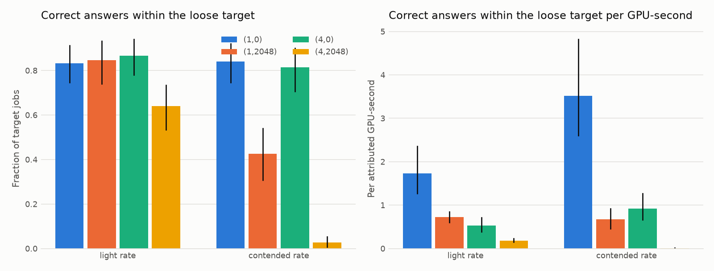
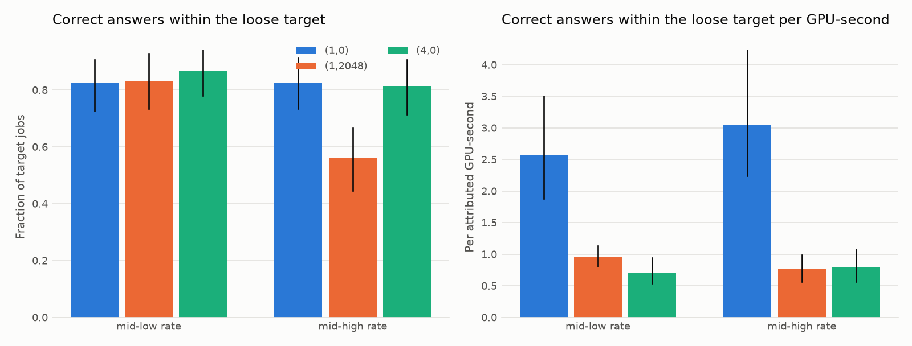
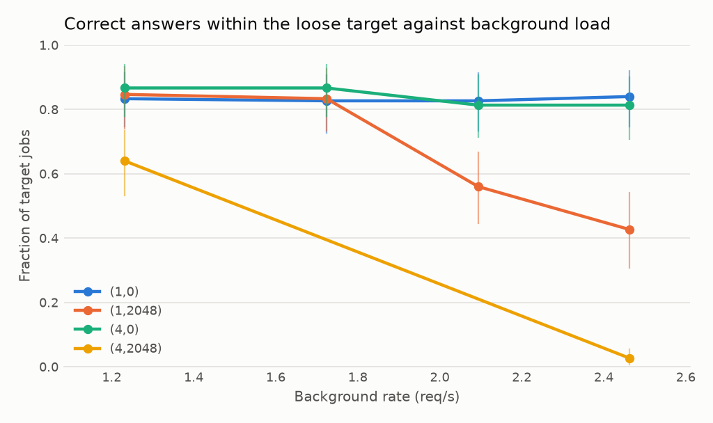

# Matched real answers across four background rates, RTX 4080 laptop, 2026-11-15

Hardware: HP Omen laptop, RTX 4080 Laptop GPU (12 GB), WSL2, vLLM 0.32.0, Qwen3-1.7B BF16. Results from other machines must not be pooled with these.

Generated by `16_make_baseline_report.py` from the logged run directories listed in `sources.json`. Every number below is formatted from a logged value; none is typed by hand.

## What was measured

- **Matched real-answer comparison:** real, graded answers to a fixed question cohort for each fixed action, next to matched synthetic background traffic at the background rates of each run.

## What was not measured

- No router or controller. Every action is fixed for a whole cell, so nothing here is a routing gain.
- Calibration and profiling use replayed lengths and score no answers.
- One machine and one server configuration. One pass per calibration rung and per profiling cell.
- Failures are kept in every denominator and listed by status; nothing was dropped.

## Figures

Matched real-answer comparison (matched-real-answers-4080-20261115): correct answers within the loose latency target, as a fraction of target jobs and per attributed GPU-second. Black lines: 95% bootstrap intervals over questions.

Matched real-answer comparison (matched-real-answers-4080-ladder-20261115): correct answers within the loose latency target, as a fraction of target jobs and per attributed GPU-second. Black lines: 95% bootstrap intervals over questions.

Matched real-answer comparison: correct answers within the loose latency target against the background rate, all matched runs. Vertical lines: 95% bootstrap intervals over questions.

## Tables

### Matched real-answer comparison

Source `/root/hpml-final-project/evaluation-results/matched-real-answers-4080-20261115`, commit `abae828`, status `complete`; blocks scored: 6, skipped: 0. Latency targets: tight 20.92 s, loose 41.84 s. Values are followed by 95% bootstrap intervals over questions.

| Rate | Action | Jobs | Seeds | Completed | No answer | Failed | Accuracy | Correct within tight | Correct within loose | Target GPU-s | Correct within tight per GPU-s | Correct within loose per GPU-s |
|---|---|---|---|---|---|---|---|---|---|---|---|---|
| light | (1,0) | 150 | 3 | 138 | 12 | 0 | 0.833 [0.753, 0.907] | 0.800 [0.693, 0.893] | 0.833 [0.747, 0.913] | 72 | 1.6647 [1.1710, 2.3797] | 1.7340 [1.2736, 2.3554] |
| light | (1,2048) | 150 | 3 | 150 | 0 | 0 | 0.847 [0.747, 0.933] | 0.360 [0.240, 0.493] | 0.847 [0.740, 0.933] | 175 | 0.3079 [0.1836, 0.4510] | 0.7241 [0.6050, 0.8502] |
| light | (4,0) | 150 | 3 | 149 | 1 | 0 | 0.867 [0.773, 0.940] | 0.793 [0.687, 0.887] | 0.867 [0.780, 0.940] | 244 | 0.4871 [0.3466, 0.6770] | 0.5321 [0.3897, 0.7123] |
| light | (4,2048) | 150 | 3 | 150 | 0 | 0 | 0.860 [0.760, 0.947] | 0.133 [0.060, 0.213] | 0.640 [0.533, 0.733] | 524 | 0.0382 [0.0162, 0.0657] | 0.1831 [0.1461, 0.2268] |
| contended | (1,0) | 150 | 3 | 141 | 9 | 0 | 0.847 [0.760, 0.920] | 0.767 [0.647, 0.873] | 0.840 [0.747, 0.920] | 36 | 3.2126 [2.2064, 4.5475] | 3.5199 [2.6076, 4.8188] |
| contended | (1,2048) | 150 | 3 | 150 | 0 | 0 | 0.820 [0.713, 0.913] | 0.113 [0.047, 0.193] | 0.427 [0.307, 0.540] | 95 | 0.1781 [0.0703, 0.3219] | 0.6703 [0.4570, 0.9152] |
| contended | (4,0) | 150 | 3 | 147 | 3 | 0 | 0.853 [0.773, 0.927] | 0.707 [0.587, 0.827] | 0.813 [0.707, 0.900] | 133 | 0.7957 [0.5521, 1.1267] | 0.9158 [0.6630, 1.2659] |
| contended | (4,2048) | 150 | 3 | 150 | 0 | 0 | 0.860 [0.767, 0.940] | 0.007 [0.000, 0.020] | 0.027 [0.007, 0.053] | 407 | 0.0025 [0.0000, 0.0078] | 0.0098 [0.0023, 0.0206] |

Per cell:

| Block | Action | Target jobs | Correct | Correct within tight | Correct within loose | Target p95 (s) | Background requests | Background within tight | Background within loose | Background p95 (s) | Waiting max | KV cache max | Preemptions | Goodput tight per GPU-s | Goodput loose per GPU-s |
|---|---|---|---|---|---|---|---|---|---|---|---|---|---|---|---|
| seed-20261116-contended | (4,2048) | 50 | 43 | 1 | 3 | 267.0 | 1021 | 10 | 188 | 161.7 | 334 | 1.00 | 2496 | 0.017 | 0.299 |
| seed-20261116-contended | control | 0 | 0 | 0 | 0 | - | 1021 | 525 | 1021 | 26.1 | 0 | 0.89 | 0 | 1.096 | 2.131 |
| seed-20261116-contended | (1,0) | 50 | 44 | 38 | 43 | 41.5 | 1021 | 430 | 1021 | 27.2 | 0 | 0.93 | 0 | 0.975 | 2.216 |
| seed-20261116-contended | (1,2048) | 50 | 41 | 5 | 18 | 75.5 | 1021 | 108 | 972 | 41.3 | 52 | 1.00 | 801 | 0.228 | 1.996 |
| seed-20261116-contended | (4,0) | 50 | 42 | 34 | 39 | 51.0 | 1021 | 169 | 1021 | 30.2 | 23 | 1.00 | 125 | 0.420 | 2.194 |
| seed-20261116-light | (1,0) | 50 | 42 | 41 | 42 | 29.1 | 504 | 504 | 504 | 16.0 | 0 | 0.41 | 0 | 1.138 | 1.140 |
| seed-20261116-light | control | 0 | 0 | 0 | 0 | - | 504 | 504 | 504 | 15.2 | 0 | 0.37 | 0 | 1.054 | 1.054 |
| seed-20261116-light | (4,0) | 50 | 43 | 39 | 43 | 31.3 | 504 | 504 | 504 | 17.2 | 0 | 0.47 | 0 | 1.131 | 1.140 |
| seed-20261116-light | (4,2048) | 50 | 43 | 6 | 30 | 46.7 | 504 | 323 | 504 | 24.3 | 0 | 0.86 | 0 | 0.666 | 1.081 |
| seed-20261116-light | (1,2048) | 50 | 42 | 18 | 42 | 32.6 | 504 | 504 | 504 | 17.3 | 0 | 0.50 | 0 | 1.070 | 1.119 |
| seed-20261117-light | (4,2048) | 50 | 43 | 7 | 33 | 45.8 | 505 | 296 | 505 | 23.8 | 0 | 0.80 | 0 | 0.620 | 1.100 |
| seed-20261117-light | (1,2048) | 50 | 42 | 19 | 42 | 33.1 | 505 | 505 | 505 | 17.0 | 0 | 0.42 | 0 | 1.089 | 1.137 |
| seed-20261117-light | (4,0) | 50 | 43 | 40 | 43 | 30.8 | 505 | 505 | 505 | 17.3 | 0 | 0.46 | 0 | 1.135 | 1.142 |
| seed-20261117-light | control | 0 | 0 | 0 | 0 | - | 505 | 505 | 505 | 15.3 | 0 | 0.34 | 0 | 1.056 | 1.056 |
| seed-20261117-light | (1,0) | 50 | 41 | 39 | 41 | 27.8 | 505 | 505 | 505 | 15.9 | 0 | 0.35 | 0 | 1.136 | 1.140 |
| seed-20261117-contended | control | 0 | 0 | 0 | 0 | - | 1045 | 529 | 1045 | 25.7 | 0 | 0.87 | 0 | 1.095 | 2.164 |
| seed-20261117-contended | (4,2048) | 50 | 43 | 0 | 1 | 245.8 | 1045 | 9 | 153 | 158.2 | 338 | 1.00 | 2411 | 0.014 | 0.245 |
| seed-20261117-contended | (4,0) | 50 | 43 | 35 | 41 | 45.9 | 1045 | 100 | 1045 | 29.2 | 17 | 1.00 | 36 | 0.273 | 2.198 |
| seed-20261117-contended | (1,2048) | 50 | 40 | 5 | 19 | 63.7 | 1045 | 74 | 1044 | 37.5 | 55 | 1.00 | 460 | 0.158 | 2.126 |
| seed-20261117-contended | (1,0) | 50 | 40 | 38 | 40 | 41.8 | 1045 | 249 | 1045 | 26.6 | 0 | 0.91 | 0 | 0.590 | 2.232 |
| seed-20261118-light | (4,2048) | 50 | 43 | 7 | 33 | 44.3 | 508 | 296 | 508 | 22.5 | 0 | 0.76 | 0 | 0.612 | 1.093 |
| seed-20261118-light | control | 0 | 0 | 0 | 0 | - | 508 | 508 | 508 | 15.6 | 0 | 0.33 | 0 | 1.065 | 1.065 |
| seed-20261118-light | (4,0) | 50 | 44 | 40 | 44 | 31.6 | 508 | 508 | 508 | 17.1 | 0 | 0.42 | 0 | 1.125 | 1.133 |
| seed-20261118-light | (1,2048) | 50 | 43 | 17 | 43 | 32.8 | 508 | 508 | 508 | 17.0 | 0 | 0.40 | 0 | 1.078 | 1.131 |
| seed-20261118-light | (1,0) | 50 | 42 | 40 | 42 | 29.2 | 508 | 508 | 508 | 16.0 | 0 | 0.35 | 0 | 1.130 | 1.134 |
| seed-20261118-contended | (4,0) | 50 | 43 | 37 | 42 | 46.5 | 990 | 174 | 990 | 25.9 | 0 | 0.87 | 0 | 0.429 | 2.097 |
| seed-20261118-contended | (1,0) | 50 | 43 | 39 | 43 | 38.9 | 990 | 553 | 990 | 23.8 | 0 | 0.83 | 0 | 1.211 | 2.112 |
| seed-20261118-contended | (1,2048) | 50 | 42 | 7 | 27 | 54.4 | 990 | 151 | 990 | 29.4 | 13 | 1.00 | 52 | 0.321 | 2.067 |
| seed-20261118-contended | control | 0 | 0 | 0 | 0 | - | 990 | 670 | 990 | 23.2 | 0 | 0.80 | 0 | 1.396 | 2.062 |
| seed-20261118-contended | (4,2048) | 50 | 43 | 0 | 0 | 254.7 | 990 | 12 | 158 | 143.9 | 298 | 1.00 | 1974 | 0.019 | 0.255 |

Paired differences between actions at the same rate (first minus second):

| Rate | Metric | Action | Minus | Questions | Difference | 95% interval | Interval excludes zero |
|---|---|---|---|---|---|---|---|
| light | correct_within_loose | (1,0) | (1,2048) | 50 | -0.0133 | [-0.0867, +0.0600] | no |
| light | correct_within_tight | (1,0) | (1,2048) | 50 | +0.4400 | [+0.3200, +0.5600] | yes |
| light | correct_within_loose_per_gpu_s | (1,0) | (1,2048) | 50 | +1.0100 | [+0.6372, +1.5647] | yes |
| light | correct_within_tight_per_gpu_s | (1,0) | (1,2048) | 50 | +1.3568 | [+0.9259, +1.9673] | yes |
| light | correct_within_loose | (1,0) | (4,0) | 50 | -0.0333 | [-0.0867, +0.0200] | no |
| light | correct_within_tight | (1,0) | (4,0) | 50 | +0.0067 | [-0.0467, +0.0533] | no |
| light | correct_within_loose_per_gpu_s | (1,0) | (4,0) | 50 | +1.2019 | [+0.8622, +1.6979] | yes |
| light | correct_within_tight_per_gpu_s | (1,0) | (4,0) | 50 | +1.1776 | [+0.8297, +1.6701] | yes |
| light | correct_within_loose | (1,0) | (4,2048) | 50 | +0.1933 | [+0.1200, +0.2733] | yes |
| light | correct_within_tight | (1,0) | (4,2048) | 50 | +0.6667 | [+0.5600, +0.7667] | yes |
| light | correct_within_loose_per_gpu_s | (1,0) | (4,2048) | 50 | +1.5509 | [+1.1109, +2.1955] | yes |
| light | correct_within_tight_per_gpu_s | (1,0) | (4,2048) | 50 | +1.6265 | [+1.1611, +2.2992] | yes |
| light | correct_within_loose | (1,2048) | (4,0) | 50 | -0.0200 | [-0.0867, +0.0467] | no |
| light | correct_within_tight | (1,2048) | (4,0) | 50 | -0.4333 | [-0.5467, -0.3200] | yes |
| light | correct_within_loose_per_gpu_s | (1,2048) | (4,0) | 50 | +0.1920 | [+0.0693, +0.2828] | yes |
| light | correct_within_tight_per_gpu_s | (1,2048) | (4,0) | 50 | -0.1792 | [-0.3364, -0.0493] | yes |
| light | correct_within_loose | (1,2048) | (4,2048) | 50 | +0.2067 | [+0.1333, +0.2867] | yes |
| light | correct_within_tight | (1,2048) | (4,2048) | 50 | +0.2267 | [+0.1333, +0.3267] | yes |
| light | correct_within_loose_per_gpu_s | (1,2048) | (4,2048) | 50 | +0.5409 | [+0.4560, +0.6280] | yes |
| light | correct_within_tight_per_gpu_s | (1,2048) | (4,2048) | 50 | +0.2697 | [+0.1619, +0.3970] | yes |
| light | correct_within_loose | (4,0) | (4,2048) | 50 | +0.2267 | [+0.1400, +0.3067] | yes |
| light | correct_within_tight | (4,0) | (4,2048) | 50 | +0.6600 | [+0.5467, +0.7667] | yes |
| light | correct_within_loose_per_gpu_s | (4,0) | (4,2048) | 50 | +0.3490 | [+0.2363, +0.5015] | yes |
| light | correct_within_tight_per_gpu_s | (4,0) | (4,2048) | 50 | +0.4489 | [+0.3195, +0.6248] | yes |
| contended | correct_within_loose | (1,0) | (1,2048) | 50 | +0.4133 | [+0.3067, +0.5133] | yes |
| contended | correct_within_tight | (1,0) | (1,2048) | 50 | +0.6533 | [+0.5400, +0.7600] | yes |
| contended | correct_within_loose_per_gpu_s | (1,0) | (1,2048) | 50 | +2.8496 | [+2.0064, +4.0284] | yes |
| contended | correct_within_tight_per_gpu_s | (1,0) | (1,2048) | 50 | +3.0346 | [+2.0989, +4.4119] | yes |
| contended | correct_within_loose | (1,0) | (4,0) | 50 | +0.0267 | [-0.0133, +0.0733] | no |
| contended | correct_within_tight | (1,0) | (4,0) | 50 | +0.0600 | [+0.0133, +0.1133] | yes |
| contended | correct_within_loose_per_gpu_s | (1,0) | (4,0) | 50 | +2.6041 | [+1.8937, +3.5135] | yes |
| contended | correct_within_tight_per_gpu_s | (1,0) | (4,0) | 50 | +2.4169 | [+1.6782, +3.4315] | yes |
| contended | correct_within_loose | (1,0) | (4,2048) | 50 | +0.8133 | [+0.7267, +0.8933] | yes |
| contended | correct_within_tight | (1,0) | (4,2048) | 50 | +0.7600 | [+0.6400, +0.8600] | yes |
| contended | correct_within_loose_per_gpu_s | (1,0) | (4,2048) | 50 | +3.5101 | [+2.5823, +4.7975] | yes |
| contended | correct_within_tight_per_gpu_s | (1,0) | (4,2048) | 50 | +3.2102 | [+2.2206, +4.6204] | yes |
| contended | correct_within_loose | (1,2048) | (4,0) | 50 | -0.3867 | [-0.4933, -0.2800] | yes |
| contended | correct_within_tight | (1,2048) | (4,0) | 50 | -0.5933 | [-0.7133, -0.4733] | yes |
| contended | correct_within_loose_per_gpu_s | (1,2048) | (4,0) | 50 | -0.2455 | [-0.4973, -0.0305] | yes |
| contended | correct_within_tight_per_gpu_s | (1,2048) | (4,0) | 50 | -0.6176 | [-0.9278, -0.3860] | yes |
| contended | correct_within_loose | (1,2048) | (4,2048) | 50 | +0.4000 | [+0.2933, +0.5133] | yes |
| contended | correct_within_tight | (1,2048) | (4,2048) | 50 | +0.1067 | [+0.0467, +0.1733] | yes |
| contended | correct_within_loose_per_gpu_s | (1,2048) | (4,2048) | 50 | +0.6605 | [+0.4442, +0.9212] | yes |
| contended | correct_within_tight_per_gpu_s | (1,2048) | (4,2048) | 50 | +0.1756 | [+0.0702, +0.3181] | yes |
| contended | correct_within_loose | (4,0) | (4,2048) | 50 | +0.7867 | [+0.6867, +0.8800] | yes |
| contended | correct_within_tight | (4,0) | (4,2048) | 50 | +0.7000 | [+0.5800, +0.8067] | yes |
| contended | correct_within_loose_per_gpu_s | (4,0) | (4,2048) | 50 | +0.9059 | [+0.6608, +1.2444] | yes |
| contended | correct_within_tight_per_gpu_s | (4,0) | (4,2048) | 50 | +0.7932 | [+0.5425, +1.1412] | yes |

Definitions: **correct_within_target**: target job completed, majority answer verified correct, and job latency (scheduled arrival to last sample) within the target; every scheduled job is in the denominator. **per_gpu_s**: correct-within-target jobs divided by the GPU seconds attributed to target jobs: cell wall time (one GPU) times the job share of all tokens generated in the cell; prompt processing is not attributed separately. **goodput_per_gpu_s**: per cell: (target jobs correct within target + background requests completed within target) / cell wall seconds. **ci95**: percentile bootstrap, 2000 resamples of questions with replacement; seeds of a question are kept together; paired differences resample the same questions for both actions.

### Matched real-answer comparison (matched-real-answers-4080-ladder-20261115)

Source `/root/hpml-final-project/evaluation-results/matched-real-answers-4080-ladder-20261115`, commit `86ee512`, status `complete`; blocks scored: 6, skipped: 0. Latency targets: tight 20.92 s, loose 41.84 s. Values are followed by 95% bootstrap intervals over questions.

| Rate | Action | Jobs | Seeds | Completed | No answer | Failed | Accuracy | Correct within tight | Correct within loose | Target GPU-s | Correct within tight per GPU-s | Correct within loose per GPU-s |
|---|---|---|---|---|---|---|---|---|---|---|---|---|
| mid-low | (1,0) | 150 | 3 | 145 | 5 | 0 | 0.827 [0.733, 0.913] | 0.800 [0.693, 0.893] | 0.827 [0.727, 0.907] | 48 | 2.4849 [1.7848, 3.4180] | 2.5677 [1.8839, 3.5045] |
| mid-low | (1,2048) | 150 | 3 | 150 | 0 | 0 | 0.833 [0.733, 0.920] | 0.287 [0.173, 0.413] | 0.833 [0.733, 0.927] | 130 | 0.3298 [0.1874, 0.5004] | 0.9588 [0.8067, 1.1300] |
| mid-low | (4,0) | 150 | 3 | 146 | 4 | 0 | 0.867 [0.780, 0.947] | 0.773 [0.653, 0.880] | 0.867 [0.780, 0.940] | 183 | 0.6336 [0.4425, 0.8890] | 0.7100 [0.5328, 0.9455] |
| mid-high | (1,0) | 150 | 3 | 144 | 6 | 0 | 0.827 [0.720, 0.913] | 0.767 [0.660, 0.860] | 0.827 [0.733, 0.913] | 41 | 2.8278 [2.0286, 4.0263] | 3.0491 [2.2360, 4.2300] |
| mid-high | (1,2048) | 150 | 3 | 150 | 0 | 0 | 0.807 [0.707, 0.900] | 0.160 [0.080, 0.247] | 0.560 [0.447, 0.667] | 110 | 0.2172 [0.1096, 0.3627] | 0.7603 [0.5667, 0.9862] |
| mid-high | (4,0) | 150 | 3 | 149 | 1 | 0 | 0.853 [0.760, 0.940] | 0.687 [0.567, 0.807] | 0.813 [0.713, 0.907] | 155 | 0.6662 [0.4628, 0.9822] | 0.7890 [0.5652, 1.0747] |

Per cell:

| Block | Action | Target jobs | Correct | Correct within tight | Correct within loose | Target p95 (s) | Background requests | Background within tight | Background within loose | Background p95 (s) | Waiting max | KV cache max | Preemptions | Goodput tight per GPU-s | Goodput loose per GPU-s |
|---|---|---|---|---|---|---|---|---|---|---|---|---|---|---|---|
| seed-20261116-mid-high | control | 0 | 0 | 0 | 0 | - | 882 | 870 | 882 | 20.4 | 0 | 0.65 | 0 | 1.814 | 1.839 |
| seed-20261116-mid-high | (1,0) | 50 | 43 | 40 | 43 | 34.0 | 882 | 768 | 882 | 21.3 | 0 | 0.68 | 0 | 1.683 | 1.927 |
| seed-20261116-mid-high | (1,2048) | 50 | 41 | 11 | 33 | 50.5 | 882 | 488 | 882 | 25.8 | 0 | 0.91 | 0 | 1.018 | 1.867 |
| seed-20261116-mid-high | (4,0) | 50 | 41 | 37 | 40 | 42.9 | 882 | 528 | 882 | 24.2 | 0 | 0.78 | 0 | 1.170 | 1.909 |
| seed-20261116-mid-low | (1,0) | 50 | 41 | 41 | 41 | 35.1 | 718 | 715 | 718 | 19.8 | 0 | 0.61 | 0 | 1.572 | 1.578 |
| seed-20261116-mid-low | (4,0) | 50 | 44 | 39 | 44 | 39.5 | 718 | 654 | 718 | 23.2 | 0 | 0.86 | 0 | 1.438 | 1.581 |
| seed-20261116-mid-low | control | 0 | 0 | 0 | 0 | - | 718 | 718 | 718 | 17.9 | 0 | 0.54 | 0 | 1.496 | 1.496 |
| seed-20261116-mid-low | (1,2048) | 50 | 42 | 13 | 42 | 39.0 | 718 | 692 | 718 | 20.7 | 0 | 0.65 | 0 | 1.436 | 1.548 |
| seed-20261117-mid-low | (1,0) | 50 | 42 | 40 | 42 | 28.3 | 707 | 707 | 707 | 18.0 | 0 | 0.50 | 0 | 1.563 | 1.567 |
| seed-20261117-mid-low | control | 0 | 0 | 0 | 0 | - | 707 | 707 | 707 | 17.7 | 0 | 0.48 | 0 | 1.479 | 1.479 |
| seed-20261117-mid-low | (4,0) | 50 | 42 | 38 | 42 | 36.9 | 707 | 705 | 707 | 19.9 | 0 | 0.62 | 0 | 1.545 | 1.557 |
| seed-20261117-mid-low | (1,2048) | 50 | 40 | 15 | 40 | 37.4 | 707 | 706 | 707 | 20.0 | 0 | 0.62 | 0 | 1.490 | 1.543 |
| seed-20261117-mid-high | (4,0) | 50 | 42 | 35 | 41 | 40.5 | 889 | 647 | 889 | 26.3 | 0 | 0.89 | 0 | 1.403 | 1.914 |
| seed-20261117-mid-high | (1,2048) | 50 | 39 | 10 | 30 | 48.8 | 889 | 447 | 889 | 25.3 | 0 | 0.82 | 0 | 0.933 | 1.876 |
| seed-20261117-mid-high | (1,0) | 50 | 40 | 40 | 40 | 27.3 | 889 | 822 | 889 | 21.1 | 0 | 0.70 | 0 | 1.792 | 1.931 |
| seed-20261117-mid-high | control | 0 | 0 | 0 | 0 | - | 889 | 869 | 889 | 20.5 | 0 | 0.66 | 0 | 1.807 | 1.848 |
| seed-20261118-mid-low | (1,2048) | 50 | 43 | 15 | 43 | 37.5 | 721 | 719 | 721 | 20.0 | 0 | 0.61 | 0 | 1.504 | 1.566 |
| seed-20261118-mid-low | (4,0) | 50 | 44 | 39 | 44 | 35.6 | 721 | 721 | 721 | 19.8 | 0 | 0.60 | 0 | 1.557 | 1.567 |
| seed-20261118-mid-low | control | 0 | 0 | 0 | 0 | - | 721 | 650 | 721 | 21.7 | 0 | 0.59 | 0 | 1.360 | 1.508 |
| seed-20261118-mid-low | (1,0) | 50 | 41 | 39 | 41 | 27.4 | 721 | 595 | 721 | 21.6 | 0 | 0.60 | 0 | 1.318 | 1.584 |
| seed-20261118-mid-high | (1,2048) | 50 | 41 | 3 | 21 | 64.9 | 852 | 54 | 852 | 34.3 | 17 | 1.00 | 111 | 0.115 | 1.756 |
| seed-20261118-mid-high | (1,0) | 50 | 41 | 35 | 41 | 43.5 | 852 | 60 | 852 | 33.9 | 0 | 0.89 | 0 | 0.191 | 1.793 |
| seed-20261118-mid-high | control | 0 | 0 | 0 | 0 | - | 852 | 121 | 852 | 26.9 | 0 | 0.86 | 0 | 0.251 | 1.764 |
| seed-20261118-mid-high | (4,0) | 50 | 45 | 31 | 41 | 59.7 | 852 | 50 | 852 | 35.9 | 10 | 1.00 | 51 | 0.163 | 1.796 |

Paired differences between actions at the same rate (first minus second):

| Rate | Metric | Action | Minus | Questions | Difference | 95% interval | Interval excludes zero |
|---|---|---|---|---|---|---|---|
| mid-low | correct_within_loose | (1,0) | (1,2048) | 50 | -0.0067 | [-0.0733, +0.0600] | no |
| mid-low | correct_within_tight | (1,0) | (1,2048) | 50 | +0.5133 | [+0.3867, +0.6333] | yes |
| mid-low | correct_within_loose_per_gpu_s | (1,0) | (1,2048) | 50 | +1.6089 | [+1.0597, +2.4145] | yes |
| mid-low | correct_within_tight_per_gpu_s | (1,0) | (1,2048) | 50 | +2.1550 | [+1.5443, +3.0261] | yes |
| mid-low | correct_within_loose | (1,0) | (4,0) | 50 | -0.0400 | [-0.0867, +0.0000] | no |
| mid-low | correct_within_tight | (1,0) | (4,0) | 50 | +0.0267 | [+0.0067, +0.0533] | yes |
| mid-low | correct_within_loose_per_gpu_s | (1,0) | (4,0) | 50 | +1.8577 | [+1.3642, +2.4916] | yes |
| mid-low | correct_within_tight_per_gpu_s | (1,0) | (4,0) | 50 | +1.8513 | [+1.3469, +2.5436] | yes |
| mid-low | correct_within_loose | (1,2048) | (4,0) | 50 | -0.0333 | [-0.0933, +0.0200] | no |
| mid-low | correct_within_tight | (1,2048) | (4,0) | 50 | -0.4867 | [-0.6067, -0.3667] | yes |
| mid-low | correct_within_loose_per_gpu_s | (1,2048) | (4,0) | 50 | +0.2488 | [+0.0821, +0.3595] | yes |
| mid-low | correct_within_tight_per_gpu_s | (1,2048) | (4,0) | 50 | -0.3037 | [-0.5195, -0.1322] | yes |
| mid-high | correct_within_loose | (1,0) | (1,2048) | 50 | +0.2667 | [+0.1800, +0.3600] | yes |
| mid-high | correct_within_tight | (1,0) | (1,2048) | 50 | +0.6067 | [+0.4933, +0.7133] | yes |
| mid-high | correct_within_loose_per_gpu_s | (1,0) | (1,2048) | 50 | +2.2889 | [+1.5885, +3.2423] | yes |
| mid-high | correct_within_tight_per_gpu_s | (1,0) | (1,2048) | 50 | +2.6106 | [+1.8534, +3.6037] | yes |
| mid-high | correct_within_loose | (1,0) | (4,0) | 50 | +0.0133 | [-0.0333, +0.0667] | no |
| mid-high | correct_within_tight | (1,0) | (4,0) | 50 | +0.0800 | [+0.0267, +0.1400] | yes |
| mid-high | correct_within_loose_per_gpu_s | (1,0) | (4,0) | 50 | +2.2601 | [+1.6745, +3.0586] | yes |
| mid-high | correct_within_tight_per_gpu_s | (1,0) | (4,0) | 50 | +2.1617 | [+1.5481, +2.9403] | yes |
| mid-high | correct_within_loose | (1,2048) | (4,0) | 50 | -0.2533 | [-0.3467, -0.1733] | yes |
| mid-high | correct_within_tight | (1,2048) | (4,0) | 50 | -0.5267 | [-0.6467, -0.4133] | yes |
| mid-high | correct_within_loose_per_gpu_s | (1,2048) | (4,0) | 50 | -0.0288 | [-0.2611, +0.1416] | no |
| mid-high | correct_within_tight_per_gpu_s | (1,2048) | (4,0) | 50 | -0.4489 | [-0.7147, -0.2533] | yes |

Definitions: **correct_within_target**: target job completed, majority answer verified correct, and job latency (scheduled arrival to last sample) within the target; every scheduled job is in the denominator. **per_gpu_s**: correct-within-target jobs divided by the GPU seconds attributed to target jobs: cell wall time (one GPU) times the job share of all tokens generated in the cell; prompt processing is not attributed separately. **goodput_per_gpu_s**: per cell: (target jobs correct within target + background requests completed within target) / cell wall seconds. **ci95**: percentile bootstrap, 2000 resamples of questions with replacement; seeds of a question are kept together; paired differences resample the same questions for both actions.
