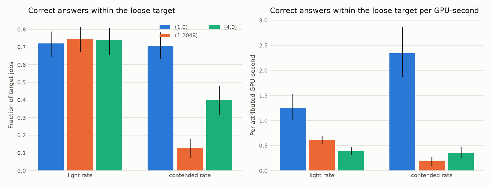
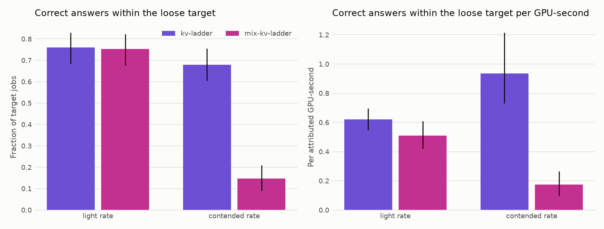

# Load-adaptive controller and load-blind mixture against fixed actions on the 150-question representative cohort, RTX 4080 laptop, 2026-11-16

Hardware: HP Omen laptop, RTX 4080 Laptop GPU (12 GB), WSL2, vLLM 0.32.0, Qwen3-1.7B BF16. Results from other machines must not be pooled with these.

Generated by `16_make_baseline_report.py` from the logged run directories listed in `sources.json`. Every number below is formatted from a logged value; none is typed by hand.

## What was measured

- **Matched real-answer comparison:** real, graded answers to a fixed question cohort for each fixed action, next to matched synthetic background traffic at the background rates of each run.
- **Per-job policies** (`kv-ladder`, `mix-kv-ladder`): an action chosen per target job by a rule frozen before the run, from a server signal read at arrival or from a fixed hash of the job. The chosen actions are listed per entry.

## What was not measured

- No learned router. A policy is a gain over a fixed action only where a paired interval against that action excludes zero; fixed-action cells keep one action for the whole cell.
- Calibration and profiling use replayed lengths and score no answers.
- One machine and one server configuration. One pass per calibration rung and per profiling cell.
- Failures are kept in every denominator and listed by status; nothing was dropped.

## Figures

Matched real-answer comparison (matched-real-answers-4080-150q-rerun-seed20261116): correct answers within the loose latency target, as a fraction of target jobs and per attributed GPU-second. Black lines: 95% bootstrap intervals over questions.

Matched real-answer comparison (matched-real-answers-4080-150q-policies-seed20261116): correct answers within the loose latency target, as a fraction of target jobs and per attributed GPU-second. Black lines: 95% bootstrap intervals over questions.

## Tables

### Matched real-answer comparison

Source `/root/hpml-final-project/evaluation-results/matched-real-answers-4080-150q-rerun-seed20261116`, commit `c758d09`, status `complete`; blocks scored: 2, skipped: 0. Latency targets: tight 20.92 s, loose 41.84 s. Values are followed by 95% bootstrap intervals over questions.

| Rate | Action | Chosen actions | Jobs | Seeds | Completed | No answer | Failed | Accuracy | Correct within tight | Correct within loose | Target GPU-s | Correct within tight per GPU-s | Correct within loose per GPU-s |
|---|---|---|---|---|---|---|---|---|---|---|---|---|---|
| light | (1,0) | - | 150 | 1 | 135 | 15 | 0 | 0.720 [0.647, 0.793] | 0.700 [0.627, 0.773] | 0.720 [0.647, 0.787] | 87 | 1.2138 [0.9740, 1.4862] | 1.2484 [1.0195, 1.5202] |
| light | (1,2048) | - | 150 | 1 | 150 | 0 | 0 | 0.747 [0.673, 0.813] | 0.207 [0.147, 0.273] | 0.747 [0.673, 0.813] | 185 | 0.1678 [0.1152, 0.2300] | 0.6063 [0.5369, 0.6804] |
| light | (4,0) | - | 150 | 1 | 145 | 5 | 0 | 0.740 [0.667, 0.807] | 0.653 [0.573, 0.727] | 0.740 [0.660, 0.807] | 288 | 0.3406 [0.2719, 0.4237] | 0.3858 [0.3187, 0.4660] |
| contended | (1,0) | - | 150 | 1 | 133 | 17 | 0 | 0.713 [0.640, 0.787] | 0.627 [0.547, 0.700] | 0.707 [0.633, 0.780] | 45 | 2.0758 [1.6225, 2.5972] | 2.3408 [1.8783, 2.8670] |
| contended | (1,2048) | - | 150 | 1 | 150 | 0 | 0 | 0.720 [0.647, 0.787] | 0.000 [0.000, 0.000] | 0.127 [0.073, 0.180] | 100 | 0.0000 [0.0000, 0.0000] | 0.1894 [0.1091, 0.2749] |
| contended | (4,0) | - | 150 | 1 | 146 | 4 | 0 | 0.733 [0.660, 0.807] | 0.107 [0.060, 0.160] | 0.400 [0.320, 0.480] | 168 | 0.0952 [0.0520, 0.1515] | 0.3571 [0.2663, 0.4644] |

Per cell:

| Block | Action | Target jobs | Correct | Correct within tight | Correct within loose | Target p95 (s) | Background requests | Background within tight | Background within loose | Background p95 (s) | Waiting max | KV cache max | Preemptions | GPU power mean (W) | Goodput tight per GPU-s | Goodput loose per GPU-s |
|---|---|---|---|---|---|---|---|---|---|---|---|---|---|---|---|---|
| seed-20261116-contended | control | 0 | 0 | 0 | 0 | - | 3031 | 1324 | 3031 | 26.7 | 0 | 0.89 | 0 | 112.9 | 1.025 | 2.346 |
| seed-20261116-contended | (1,2048) | 150 | 108 | 0 | 19 | 110.6 | 3031 | 63 | 1770 | 63.0 | 122 | 1.00 | 3768 | 114.6 | 0.047 | 1.342 |
| seed-20261116-contended | (1,0) | 150 | 107 | 94 | 106 | 50.4 | 3031 | 483 | 3031 | 32.7 | 21 | 1.00 | 310 | 113.0 | 0.445 | 2.419 |
| seed-20261116-contended | (4,0) | 150 | 110 | 16 | 60 | 90.4 | 3031 | 12 | 616 | 72.5 | 172 | 1.00 | 5314 | 111.6 | 0.021 | 0.502 |
| seed-20261116-light | control | 0 | 0 | 0 | 0 | - | 1496 | 1496 | 1496 | 16.0 | 0 | 0.34 | 0 | 102.5 | 1.161 | 1.161 |
| seed-20261116-light | (1,0) | 150 | 108 | 105 | 108 | 29.4 | 1496 | 1496 | 1496 | 16.6 | 0 | 0.38 | 0 | 102.8 | 1.238 | 1.241 |
| seed-20261116-light | (4,0) | 150 | 111 | 98 | 111 | 34.0 | 1496 | 1496 | 1496 | 18.6 | 0 | 0.51 | 0 | 112.8 | 1.232 | 1.242 |
| seed-20261116-light | (1,2048) | 150 | 112 | 31 | 112 | 35.2 | 1496 | 1496 | 1496 | 18.2 | 0 | 0.47 | 0 | 104.0 | 1.181 | 1.243 |

Paired differences between actions at the same rate (first minus second):

| Rate | Metric | Action | Minus | Questions | Difference | 95% interval | Interval excludes zero |
|---|---|---|---|---|---|---|---|
| light | accuracy | (1,0) | (1,2048) | 150 | -0.0267 | [-0.1000, +0.0467] | no |
| light | correct_within_loose | (1,0) | (1,2048) | 150 | -0.0267 | [-0.1067, +0.0467] | no |
| light | correct_within_tight | (1,0) | (1,2048) | 150 | +0.4933 | [+0.4133, +0.5733] | yes |
| light | correct_within_loose_per_gpu_s | (1,0) | (1,2048) | 150 | +0.6422 | [+0.4310, +0.8697] | yes |
| light | correct_within_tight_per_gpu_s | (1,0) | (1,2048) | 150 | +1.0460 | [+0.8459, +1.3080] | yes |
| light | accuracy | (1,0) | (4,0) | 150 | -0.0200 | [-0.0733, +0.0333] | no |
| light | correct_within_loose | (1,0) | (4,0) | 150 | -0.0200 | [-0.0800, +0.0333] | no |
| light | correct_within_tight | (1,0) | (4,0) | 150 | +0.0467 | [-0.0067, +0.1000] | no |
| light | correct_within_loose_per_gpu_s | (1,0) | (4,0) | 150 | +0.8627 | [+0.6919, +1.0743] | yes |
| light | correct_within_tight_per_gpu_s | (1,0) | (4,0) | 150 | +0.8732 | [+0.6957, +1.0706] | yes |
| light | accuracy | (1,2048) | (4,0) | 150 | +0.0067 | [-0.0667, +0.0800] | no |
| light | correct_within_loose | (1,2048) | (4,0) | 150 | +0.0067 | [-0.0667, +0.0800] | no |
| light | correct_within_tight | (1,2048) | (4,0) | 150 | -0.4467 | [-0.5267, -0.3667] | yes |
| light | correct_within_loose_per_gpu_s | (1,2048) | (4,0) | 150 | +0.2205 | [+0.1594, +0.2769] | yes |
| light | correct_within_tight_per_gpu_s | (1,2048) | (4,0) | 150 | -0.1728 | [-0.2532, -0.1011] | yes |
| contended | accuracy | (1,0) | (1,2048) | 150 | -0.0067 | [-0.0800, +0.0667] | no |
| contended | correct_within_loose | (1,0) | (1,2048) | 150 | +0.5800 | [+0.5000, +0.6533] | yes |
| contended | correct_within_tight | (1,0) | (1,2048) | 150 | +0.6267 | [+0.5467, +0.7067] | yes |
| contended | correct_within_loose_per_gpu_s | (1,0) | (1,2048) | 150 | +2.1514 | [+1.7381, +2.6673] | yes |
| contended | correct_within_tight_per_gpu_s | (1,0) | (1,2048) | 150 | +2.0758 | [+1.6270, +2.6371] | yes |
| contended | accuracy | (1,0) | (4,0) | 150 | -0.0200 | [-0.0667, +0.0267] | no |
| contended | correct_within_loose | (1,0) | (4,0) | 150 | +0.3067 | [+0.2333, +0.3867] | yes |
| contended | correct_within_tight | (1,0) | (4,0) | 150 | +0.5200 | [+0.4400, +0.6000] | yes |
| contended | correct_within_loose_per_gpu_s | (1,0) | (4,0) | 150 | +1.9836 | [+1.6146, +2.4486] | yes |
| contended | correct_within_tight_per_gpu_s | (1,0) | (4,0) | 150 | +1.9805 | [+1.5681, +2.4500] | yes |
| contended | accuracy | (1,2048) | (4,0) | 150 | -0.0133 | [-0.0867, +0.0533] | no |
| contended | correct_within_loose | (1,2048) | (4,0) | 150 | -0.2733 | [-0.3467, -0.2000] | yes |
| contended | correct_within_tight | (1,2048) | (4,0) | 150 | -0.1067 | [-0.1667, -0.0600] | yes |
| contended | correct_within_loose_per_gpu_s | (1,2048) | (4,0) | 150 | -0.1678 | [-0.2769, -0.0718] | yes |
| contended | correct_within_tight_per_gpu_s | (1,2048) | (4,0) | 150 | -0.0952 | [-0.1478, -0.0505] | yes |

Definitions: **correct_within_target**: target job completed, majority answer verified correct, and job latency (scheduled arrival to last sample) within the target; every scheduled job is in the denominator. **per_gpu_s**: correct-within-target jobs divided by the GPU seconds attributed to target jobs: cell wall time (one GPU) times the job share of all tokens generated in the cell; prompt processing is not attributed separately. **goodput_per_gpu_s**: per cell: (target jobs correct within target + background requests completed within target) / cell wall seconds. **ci95**: percentile bootstrap, 2000 resamples of questions with replacement; seeds of a question are kept together; paired differences resample the same questions for both actions.

### Matched real-answer comparison (matched-real-answers-4080-150q-policies-seed20261116)

Source `/root/hpml-final-project/evaluation-results/matched-real-answers-4080-150q-policies-seed20261116`, commit `7f0fb86`, status `complete`; blocks scored: 2, skipped: 0. Latency targets: tight 20.92 s, loose 41.84 s. Values are followed by 95% bootstrap intervals over questions.

| Rate | Action | Chosen actions | Jobs | Seeds | Completed | No answer | Failed | Accuracy | Correct within tight | Correct within loose | Target GPU-s | Correct within tight per GPU-s | Correct within loose per GPU-s |
|---|---|---|---|---|---|---|---|---|---|---|---|---|---|
| light | kv-ladder | 1:2048 150 | 150 | 1 | 150 | 0 | 0 | 0.760 [0.687, 0.827] | 0.207 [0.140, 0.273] | 0.760 [0.687, 0.827] | 183 | 0.1690 [0.1151, 0.2329] | 0.6214 [0.5519, 0.6942] |
| light | mix-kv-ladder | 1:0 13, 1:2048 85, 4:0 52 | 150 | 1 | 146 | 4 | 0 | 0.753 [0.680, 0.820] | 0.393 [0.320, 0.467] | 0.753 [0.680, 0.820] | 222 | 0.2659 [0.1996, 0.3401] | 0.5093 [0.4257, 0.6046] |
| contended | kv-ladder | 1:0 72, 1:2048 4, 4:0 74 | 150 | 1 | 144 | 6 | 0 | 0.733 [0.660, 0.800] | 0.540 [0.460, 0.620] | 0.680 [0.607, 0.753] | 109 | 0.7420 [0.5626, 0.9698] | 0.9344 [0.7345, 1.2109] |
| contended | mix-kv-ladder | 1:0 13, 1:2048 85, 4:0 52 | 150 | 1 | 147 | 3 | 0 | 0.733 [0.660, 0.800] | 0.020 [0.000, 0.047] | 0.147 [0.093, 0.207] | 125 | 0.0239 [0.0000, 0.0548] | 0.1755 [0.1028, 0.2613] |

Per cell:

| Block | Action | Target jobs | Correct | Correct within tight | Correct within loose | Target p95 (s) | Background requests | Background within tight | Background within loose | Background p95 (s) | Waiting max | KV cache max | Preemptions | GPU power mean (W) | Goodput tight per GPU-s | Goodput loose per GPU-s |
|---|---|---|---|---|---|---|---|---|---|---|---|---|---|---|---|---|
| seed-20261116-contended | control | 0 | 0 | 0 | 0 | - | 3031 | 1434 | 3031 | 26.2 | 0 | 0.88 | 0 | 107.1 | 1.110 | 2.346 |
| seed-20261116-contended | mix-kv-ladder | 150 | 110 | 3 | 22 | 168.0 | 3031 | 29 | 417 | 97.6 | 215 | 1.00 | 4976 | - | 0.023 | 0.319 |
| seed-20261116-contended | kv-ladder | 150 | 110 | 81 | 102 | 62.3 | 3031 | 152 | 2881 | 41.8 | 59 | 1.00 | 2552 | - | 0.179 | 2.293 |
| seed-20261116-light | control | 0 | 0 | 0 | 0 | - | 1496 | 1496 | 1496 | 15.9 | 0 | 0.38 | 0 | - | 1.161 | 1.161 |
| seed-20261116-light | kv-ladder | 150 | 114 | 31 | 114 | 34.9 | 1496 | 1496 | 1496 | 18.2 | 0 | 0.46 | 0 | 104.5 | 1.180 | 1.245 |
| seed-20261116-light | mix-kv-ladder | 150 | 113 | 59 | 113 | 35.3 | 1496 | 1492 | 1496 | 19.3 | 0 | 0.54 | 0 | 103.3 | 1.199 | 1.244 |

Paired differences between actions at the same rate (first minus second):

| Rate | Metric | Action | Minus | Questions | Difference | 95% interval | Interval excludes zero |
|---|---|---|---|---|---|---|---|
| light | accuracy | kv-ladder | mix-kv-ladder | 150 | +0.0067 | [-0.0533, +0.0600] | no |
| light | correct_within_loose | kv-ladder | mix-kv-ladder | 150 | +0.0067 | [-0.0467, +0.0600] | no |
| light | correct_within_tight | kv-ladder | mix-kv-ladder | 150 | -0.1867 | [-0.2667, -0.1133] | yes |
| light | correct_within_loose_per_gpu_s | kv-ladder | mix-kv-ladder | 150 | +0.1120 | [+0.0409, +0.1790] | yes |
| light | correct_within_tight_per_gpu_s | kv-ladder | mix-kv-ladder | 150 | -0.0970 | [-0.1634, -0.0362] | yes |
| contended | accuracy | kv-ladder | mix-kv-ladder | 150 | +0.0000 | [-0.0667, +0.0667] | no |
| contended | correct_within_loose | kv-ladder | mix-kv-ladder | 150 | +0.5333 | [+0.4467, +0.6133] | yes |
| contended | correct_within_tight | kv-ladder | mix-kv-ladder | 150 | +0.5200 | [+0.4400, +0.6000] | yes |
| contended | correct_within_loose_per_gpu_s | kv-ladder | mix-kv-ladder | 150 | +0.7589 | [+0.5757, +1.0016] | yes |
| contended | correct_within_tight_per_gpu_s | kv-ladder | mix-kv-ladder | 150 | +0.7181 | [+0.5450, +0.9461] | yes |

Definitions: **correct_within_target**: target job completed, majority answer verified correct, and job latency (scheduled arrival to last sample) within the target; every scheduled job is in the denominator. **per_gpu_s**: correct-within-target jobs divided by the GPU seconds attributed to target jobs: cell wall time (one GPU) times the job share of all tokens generated in the cell; prompt processing is not attributed separately. **goodput_per_gpu_s**: per cell: (target jobs correct within target + background requests completed within target) / cell wall seconds. **ci95**: percentile bootstrap, 2000 resamples of questions with replacement; seeds of a question are kept together; paired differences resample the same questions for both actions.
