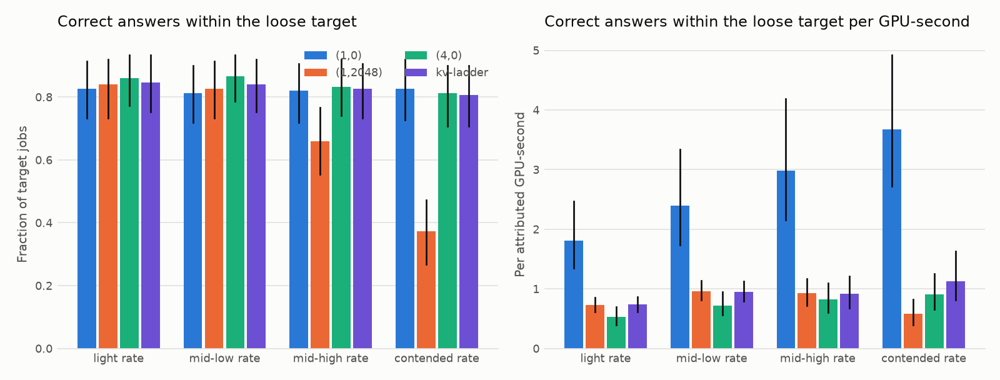
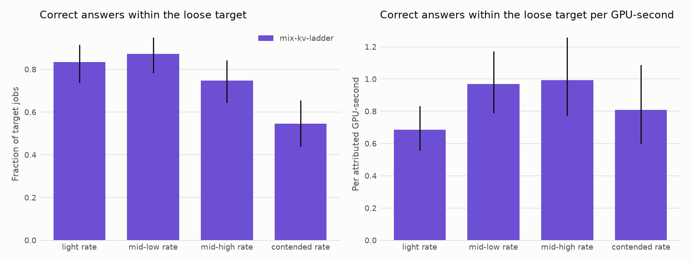
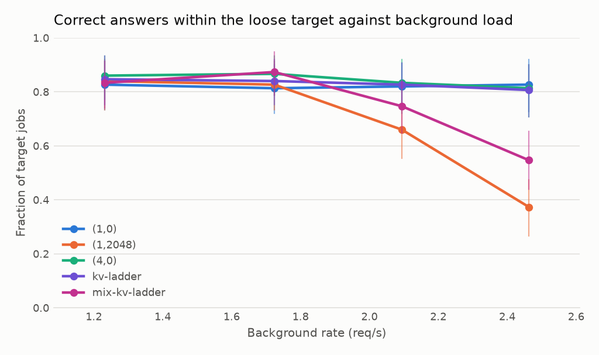

# Load-adaptive controller against fixed actions and a load-blind mixture at four background rates, RTX 4080 laptop, 2026-11-16

Hardware: HP Omen laptop, RTX 4080 Laptop GPU (12 GB), WSL2, vLLM 0.32.0, Qwen3-1.7B BF16. Results from other machines must not be pooled with these.

Generated by `16_make_baseline_report.py` from the logged run directories listed in `sources.json`. Every number below is formatted from a logged value; none is typed by hand.

## What was measured

- **Matched real-answer comparison:** real, graded answers to a fixed question cohort for each fixed action, next to matched synthetic background traffic at the background rates of each run.
- **Per-job policies** (`kv-ladder`, `mix-kv-ladder`): an action chosen per target job by a rule frozen before the run, from a server signal read at arrival or from a fixed hash of the job. The chosen actions are listed per entry.

## What was not measured

- No learned router. A policy is a gain over a fixed action only where a paired interval against that action excludes zero; fixed-action cells keep one action for the whole cell.
- Calibration and profiling use replayed lengths and score no answers.
- One machine and one server configuration. One pass per calibration rung and per profiling cell.
- Failures are kept in every denominator and listed by status; nothing was dropped.

## Figures

Matched real-answer comparison (matched-real-answers-4080-controller-20261116): correct answers within the loose latency target, as a fraction of target jobs and per attributed GPU-second. Black lines: 95% bootstrap intervals over questions.

Matched real-answer comparison (matched-real-answers-4080-mixture-20261116): correct answers within the loose latency target, as a fraction of target jobs and per attributed GPU-second. Black lines: 95% bootstrap intervals over questions.

Matched real-answer comparison: correct answers within the loose latency target against the background rate, all matched runs. Vertical lines: 95% bootstrap intervals over questions.

## Tables

### Matched real-answer comparison

Source `/root/hpml-final-project/evaluation-results/matched-real-answers-4080-controller-20261116`, commit `86f8ba9`, status `complete`; blocks scored: 12, skipped: 0. Latency targets: tight 20.92 s, loose 41.84 s. Values are followed by 95% bootstrap intervals over questions.

| Rate | Action | Chosen actions | Jobs | Seeds | Completed | No answer | Failed | Accuracy | Correct within tight | Correct within loose | Target GPU-s | Correct within tight per GPU-s | Correct within loose per GPU-s |
|---|---|---|---|---|---|---|---|---|---|---|---|---|---|
| light | (1,0) | - | 150 | 3 | 144 | 6 | 0 | 0.827 [0.733, 0.907] | 0.813 [0.707, 0.900] | 0.827 [0.733, 0.913] | 68 | 1.7825 [1.2763, 2.4684] | 1.8117 [1.3509, 2.4644] |
| light | (1,2048) | - | 150 | 3 | 150 | 0 | 0 | 0.840 [0.747, 0.927] | 0.353 [0.227, 0.480] | 0.840 [0.733, 0.920] | 174 | 0.3049 [0.1878, 0.4467] | 0.7248 [0.6096, 0.8513] |
| light | (4,0) | - | 150 | 3 | 149 | 1 | 0 | 0.860 [0.767, 0.940] | 0.767 [0.653, 0.867] | 0.860 [0.773, 0.933] | 245 | 0.4694 [0.3283, 0.6650] | 0.5266 [0.3931, 0.6988] |
| light | kv-ladder | 1:2048 150 | 150 | 3 | 150 | 0 | 0 | 0.847 [0.753, 0.933] | 0.360 [0.247, 0.487] | 0.847 [0.753, 0.933] | 172 | 0.3134 [0.1960, 0.4529] | 0.7371 [0.6166, 0.8639] |
| mid-low | (1,0) | - | 150 | 3 | 143 | 7 | 0 | 0.813 [0.713, 0.900] | 0.800 [0.700, 0.893] | 0.813 [0.720, 0.900] | 51 | 2.3556 [1.6842, 3.3066] | 2.3949 [1.7314, 3.3354] |
| mid-low | (1,2048) | - | 150 | 3 | 150 | 0 | 0 | 0.840 [0.740, 0.927] | 0.313 [0.200, 0.440] | 0.827 [0.733, 0.913] | 130 | 0.3628 [0.2126, 0.5428] | 0.9571 [0.8082, 1.1331] |
| mid-low | (4,0) | - | 150 | 3 | 149 | 1 | 0 | 0.873 [0.800, 0.940] | 0.780 [0.667, 0.880] | 0.867 [0.787, 0.933] | 180 | 0.6504 [0.4584, 0.8966] | 0.7227 [0.5562, 0.9520] |
| mid-low | kv-ladder | 1:2048 135, 4:0 15 | 150 | 3 | 150 | 0 | 0 | 0.840 [0.753, 0.920] | 0.373 [0.253, 0.500] | 0.840 [0.753, 0.920] | 133 | 0.4197 [0.2724, 0.6017] | 0.9443 [0.7893, 1.1224] |
| mid-high | (1,0) | - | 150 | 3 | 141 | 9 | 0 | 0.820 [0.720, 0.913] | 0.793 [0.693, 0.887] | 0.820 [0.720, 0.907] | 41 | 2.8846 [2.0526, 4.1015] | 2.9816 [2.1501, 4.1921] |
| mid-high | (1,2048) | - | 150 | 3 | 150 | 0 | 0 | 0.833 [0.733, 0.920] | 0.220 [0.127, 0.320] | 0.660 [0.553, 0.767] | 107 | 0.3091 [0.1711, 0.4955] | 0.9274 [0.7160, 1.1654] |
| mid-high | (4,0) | - | 150 | 3 | 147 | 3 | 0 | 0.833 [0.733, 0.920] | 0.733 [0.620, 0.847] | 0.833 [0.740, 0.920] | 151 | 0.7263 [0.5140, 1.0436] | 0.8254 [0.6029, 1.0973] |
| mid-high | kv-ladder | 1:0 5, 1:2048 62, 4:0 83 | 150 | 3 | 149 | 1 | 0 | 0.853 [0.767, 0.927] | 0.580 [0.480, 0.687] | 0.827 [0.733, 0.907] | 135 | 0.6456 [0.4488, 0.8962] | 0.9202 [0.6805, 1.2111] |
| contended | (1,0) | - | 150 | 3 | 145 | 5 | 0 | 0.827 [0.733, 0.913] | 0.773 [0.660, 0.880] | 0.827 [0.727, 0.920] | 34 | 3.4391 [2.4404, 4.7208] | 3.6762 [2.7192, 4.9188] |
| contended | (1,2048) | - | 150 | 3 | 150 | 0 | 0 | 0.833 [0.727, 0.927] | 0.140 [0.067, 0.227] | 0.373 [0.267, 0.473] | 96 | 0.2196 [0.0988, 0.3794] | 0.5857 [0.3949, 0.8254] |
| contended | (4,0) | - | 150 | 3 | 149 | 1 | 0 | 0.853 [0.773, 0.933] | 0.633 [0.520, 0.753] | 0.813 [0.707, 0.900] | 135 | 0.7045 [0.4784, 1.0235] | 0.9047 [0.6606, 1.2497] |
| contended | kv-ladder | 1:0 41, 1:2048 10, 4:0 99 | 150 | 3 | 149 | 1 | 0 | 0.827 [0.740, 0.907] | 0.667 [0.540, 0.780] | 0.807 [0.707, 0.900] | 107 | 0.9358 [0.6272, 1.3958] | 1.1323 [0.8092, 1.6259] |

Per cell:

| Block | Action | Target jobs | Correct | Correct within tight | Correct within loose | Target p95 (s) | Background requests | Background within tight | Background within loose | Background p95 (s) | Waiting max | KV cache max | Preemptions | GPU power mean (W) | Goodput tight per GPU-s | Goodput loose per GPU-s |
|---|---|---|---|---|---|---|---|---|---|---|---|---|---|---|---|---|
| seed-20261120-mid-low | control | 0 | 0 | 0 | 0 | - | 686 | 686 | 686 | 17.1 | 0 | 0.42 | 0 | 114.5 | 1.433 | 1.433 |
| seed-20261120-mid-low | (4,0) | 50 | 42 | 38 | 42 | 33.8 | 686 | 647 | 686 | 21.0 | 0 | 0.73 | 0 | 114.9 | 1.401 | 1.489 |
| seed-20261120-mid-low | kv-ladder | 50 | 42 | 16 | 42 | 40.7 | 686 | 652 | 686 | 20.9 | 0 | 0.68 | 0 | 114.9 | 1.363 | 1.486 |
| seed-20261120-mid-low | (1,0) | 50 | 38 | 38 | 38 | 32.7 | 686 | 686 | 686 | 18.4 | 0 | 0.51 | 0 | 114.9 | 1.484 | 1.484 |
| seed-20261120-mid-low | (1,2048) | 50 | 42 | 17 | 42 | 39.1 | 686 | 681 | 686 | 20.0 | 0 | 0.56 | 0 | 114.9 | 1.425 | 1.486 |
| seed-20261120-light | (1,2048) | 50 | 42 | 19 | 42 | 33.4 | 472 | 472 | 472 | 17.0 | 0 | 0.41 | 0 | 114.9 | 1.013 | 1.060 |
| seed-20261120-light | (4,0) | 50 | 43 | 39 | 43 | 33.2 | 472 | 472 | 472 | 17.8 | 0 | 0.53 | 0 | 114.9 | 1.050 | 1.058 |
| seed-20261120-light | (1,0) | 50 | 39 | 39 | 39 | 27.6 | 472 | 472 | 472 | 15.3 | 0 | 0.31 | 0 | 114.9 | 1.056 | 1.056 |
| seed-20261120-light | kv-ladder | 50 | 43 | 21 | 43 | 33.2 | 472 | 472 | 472 | 16.8 | 0 | 0.40 | 0 | 114.9 | 1.017 | 1.062 |
| seed-20261120-light | control | 0 | 0 | 0 | 0 | - | 472 | 472 | 472 | 14.7 | 0 | 0.28 | 0 | 114.9 | 0.994 | 0.994 |
| seed-20261120-mid-high | (1,0) | 50 | 41 | 40 | 41 | 39.4 | 840 | 829 | 840 | 20.5 | 0 | 0.61 | 0 | 114.9 | 1.781 | 1.806 |
| seed-20261120-mid-high | kv-ladder | 50 | 42 | 29 | 41 | 42.8 | 840 | 525 | 840 | 23.9 | 0 | 0.87 | 0 | 114.8 | 1.133 | 1.802 |
| seed-20261120-mid-high | control | 0 | 0 | 0 | 0 | - | 840 | 838 | 840 | 19.7 | 0 | 0.59 | 0 | 114.9 | 1.750 | 1.754 |
| seed-20261120-mid-high | (1,2048) | 50 | 40 | 14 | 34 | 45.4 | 840 | 486 | 840 | 23.4 | 0 | 0.81 | 0 | 114.9 | 1.021 | 1.784 |
| seed-20261120-mid-high | (4,0) | 50 | 41 | 37 | 41 | 38.2 | 840 | 657 | 840 | 23.2 | 0 | 0.90 | 0 | 114.9 | 1.414 | 1.795 |
| seed-20261120-contended | (1,0) | 50 | 40 | 39 | 40 | 23.4 | 990 | 447 | 990 | 22.8 | 0 | 0.78 | 0 | 114.9 | 1.006 | 2.133 |
| seed-20261120-contended | (4,0) | 50 | 45 | 35 | 42 | 52.3 | 990 | 165 | 990 | 28.7 | 7 | 1.00 | 16 | 114.9 | 0.405 | 2.089 |
| seed-20261120-contended | control | 0 | 0 | 0 | 0 | - | 990 | 573 | 990 | 22.4 | 0 | 0.75 | 0 | 114.9 | 1.192 | 2.059 |
| seed-20261120-contended | kv-ladder | 50 | 43 | 36 | 42 | 53.1 | 990 | 159 | 990 | 29.6 | 22 | 1.00 | 39 | 114.9 | 0.399 | 2.111 |
| seed-20261120-contended | (1,2048) | 50 | 42 | 9 | 24 | 52.7 | 990 | 135 | 990 | 27.6 | 0 | 0.96 | 0 | 114.9 | 0.292 | 2.057 |
| seed-20261121-mid-low | (1,0) | 50 | 41 | 40 | 41 | 34.3 | 741 | 741 | 741 | 19.6 | 0 | 0.54 | 0 | 115.0 | 1.631 | 1.633 |
| seed-20261121-mid-low | kv-ladder | 50 | 43 | 23 | 43 | 40.8 | 741 | 660 | 741 | 22.1 | 0 | 0.69 | 0 | 110.4 | 1.414 | 1.623 |
| seed-20261121-mid-low | (4,0) | 50 | 45 | 39 | 44 | 38.9 | 741 | 596 | 741 | 21.7 | 0 | 0.75 | 0 | 114.7 | 1.323 | 1.636 |
| seed-20261121-mid-low | control | 0 | 0 | 0 | 0 | - | 741 | 741 | 741 | 18.6 | 0 | 0.50 | 0 | 112.0 | 1.547 | 1.547 |
| seed-20261121-mid-low | (1,2048) | 50 | 39 | 14 | 37 | 43.7 | 741 | 616 | 741 | 22.3 | 0 | 0.69 | 0 | 113.9 | 1.313 | 1.621 |
| seed-20261121-contended | kv-ladder | 50 | 38 | 29 | 37 | 52.6 | 1073 | 87 | 1073 | 37.6 | 42 | 1.00 | 701 | 114.9 | 0.237 | 2.270 |
| seed-20261121-contended | (1,0) | 50 | 40 | 38 | 40 | 48.9 | 1073 | 246 | 1073 | 28.6 | 0 | 0.98 | 0 | 114.9 | 0.587 | 2.300 |
| seed-20261121-contended | (4,0) | 50 | 40 | 25 | 39 | 62.6 | 1073 | 79 | 929 | 46.7 | 80 | 1.00 | 1382 | 114.9 | 0.210 | 1.951 |
| seed-20261121-contended | (1,2048) | 50 | 40 | 4 | 10 | 102.9 | 1073 | 42 | 605 | 58.5 | 107 | 1.00 | 1338 | 114.2 | 0.089 | 1.187 |
| seed-20261121-contended | control | 0 | 0 | 0 | 0 | - | 1073 | 340 | 1073 | 28.0 | 0 | 0.93 | 0 | 114.9 | 0.703 | 2.217 |
| seed-20261121-mid-high | control | 0 | 0 | 0 | 0 | - | 921 | 711 | 921 | 21.9 | 0 | 0.73 | 0 | 114.8 | 1.475 | 1.911 |
| seed-20261121-mid-high | (1,0) | 50 | 39 | 38 | 39 | 38.3 | 921 | 615 | 921 | 22.9 | 0 | 0.76 | 0 | 111.6 | 1.355 | 1.992 |
| seed-20261121-mid-high | (1,2048) | 50 | 43 | 8 | 31 | 49.7 | 921 | 322 | 921 | 26.4 | 0 | 0.88 | 0 | 114.4 | 0.680 | 1.963 |
| seed-20261121-mid-high | kv-ladder | 50 | 43 | 31 | 41 | 50.4 | 921 | 428 | 921 | 27.2 | 0 | 0.96 | 0 | 112.5 | 0.950 | 1.992 |
| seed-20261121-mid-high | (4,0) | 50 | 40 | 35 | 40 | 44.5 | 921 | 420 | 921 | 26.8 | 0 | 0.94 | 0 | 114.9 | 0.942 | 1.990 |
| seed-20261121-light | kv-ladder | 50 | 43 | 15 | 43 | 36.4 | 531 | 531 | 531 | 18.3 | 0 | 0.45 | 0 | - | 1.140 | 1.199 |
| seed-20261121-light | (4,0) | 50 | 42 | 39 | 42 | 30.2 | 531 | 531 | 531 | 18.1 | 0 | 0.50 | 0 | 108.9 | 1.193 | 1.199 |
| seed-20261121-light | (1,2048) | 50 | 43 | 15 | 43 | 36.6 | 531 | 531 | 531 | 18.4 | 0 | 0.45 | 0 | - | 1.140 | 1.199 |
| seed-20261121-light | (1,0) | 50 | 41 | 40 | 41 | 28.1 | 531 | 531 | 531 | 16.0 | 0 | 0.36 | 0 | - | 1.195 | 1.197 |
| seed-20261121-light | control | 0 | 0 | 0 | 0 | - | 531 | 531 | 531 | 15.6 | 0 | 0.32 | 0 | 113.7 | 1.111 | 1.111 |
| seed-20261122-light | control | 0 | 0 | 0 | 0 | - | 493 | 493 | 493 | 15.2 | 0 | 0.33 | 0 | 114.1 | 1.034 | 1.034 |
| seed-20261122-light | (1,0) | 50 | 44 | 43 | 44 | 22.8 | 493 | 493 | 493 | 15.5 | 0 | 0.35 | 0 | - | 1.124 | 1.126 |
| seed-20261122-light | kv-ladder | 50 | 41 | 18 | 41 | 32.8 | 493 | 493 | 493 | 16.8 | 0 | 0.41 | 0 | - | 1.058 | 1.106 |
| seed-20261122-light | (4,0) | 50 | 44 | 37 | 44 | 34.8 | 493 | 493 | 493 | 18.3 | 0 | 0.55 | 0 | - | 1.109 | 1.124 |
| seed-20261122-light | (1,2048) | 50 | 41 | 19 | 41 | 33.0 | 493 | 493 | 493 | 17.0 | 0 | 0.41 | 0 | - | 1.063 | 1.108 |
| seed-20261122-mid-high | (4,0) | 50 | 44 | 38 | 44 | 42.5 | 836 | 309 | 836 | 24.8 | 0 | 0.76 | 0 | 104.6 | 0.723 | 1.834 |
| seed-20261122-mid-high | control | 0 | 0 | 0 | 0 | - | 836 | 794 | 836 | 20.9 | 0 | 0.66 | 0 | 114.1 | 1.662 | 1.749 |
| seed-20261122-mid-high | kv-ladder | 50 | 43 | 27 | 42 | 41.8 | 836 | 434 | 836 | 22.5 | 0 | 0.72 | 0 | 113.9 | 0.959 | 1.826 |
| seed-20261122-mid-high | (1,0) | 50 | 43 | 41 | 43 | 27.7 | 836 | 786 | 836 | 21.0 | 0 | 0.67 | 0 | 111.5 | 1.727 | 1.836 |
| seed-20261122-mid-high | (1,2048) | 50 | 42 | 11 | 34 | 42.8 | 836 | 389 | 836 | 24.4 | 0 | 0.80 | 0 | 110.5 | 0.828 | 1.802 |
| seed-20261122-mid-low | control | 0 | 0 | 0 | 0 | - | 692 | 692 | 692 | 17.8 | 0 | 0.48 | 0 | 112.7 | 1.445 | 1.445 |
| seed-20261122-mid-low | (1,0) | 50 | 43 | 42 | 43 | 33.5 | 692 | 692 | 692 | 18.5 | 0 | 0.50 | 0 | - | 1.532 | 1.534 |
| seed-20261122-mid-low | (4,0) | 50 | 44 | 40 | 44 | 37.1 | 692 | 687 | 692 | 20.4 | 0 | 0.59 | 0 | - | 1.515 | 1.534 |
| seed-20261122-mid-low | kv-ladder | 50 | 41 | 17 | 41 | 38.2 | 692 | 689 | 692 | 20.2 | 0 | 0.57 | 0 | - | 1.453 | 1.509 |
| seed-20261122-mid-low | (1,2048) | 50 | 45 | 16 | 45 | 38.3 | 692 | 691 | 692 | 20.1 | 0 | 0.58 | 0 | - | 1.461 | 1.523 |
| seed-20261122-contended | (4,0) | 50 | 43 | 35 | 41 | 50.2 | 991 | 113 | 991 | 28.5 | 14 | 1.00 | 30 | - | 0.305 | 2.128 |
| seed-20261122-contended | (1,0) | 50 | 44 | 39 | 44 | 34.3 | 991 | 405 | 991 | 25.5 | 0 | 0.84 | 0 | - | 0.918 | 2.139 |
| seed-20261122-contended | (1,2048) | 50 | 43 | 8 | 22 | 58.5 | 991 | 78 | 991 | 31.1 | 20 | 1.00 | 114 | 114.9 | 0.176 | 2.072 |
| seed-20261122-contended | control | 0 | 0 | 0 | 0 | - | 991 | 569 | 991 | 24.7 | 0 | 0.83 | 0 | 114.9 | 1.178 | 2.052 |
| seed-20261122-contended | kv-ladder | 50 | 43 | 35 | 42 | 48.3 | 991 | 144 | 991 | 27.5 | 0 | 0.97 | 0 | 114.9 | 0.369 | 2.130 |

Paired differences between actions at the same rate (first minus second):

| Rate | Metric | Action | Minus | Questions | Difference | 95% interval | Interval excludes zero |
|---|---|---|---|---|---|---|---|
| light | accuracy | (1,0) | (1,2048) | 50 | -0.0133 | [-0.0867, +0.0600] | no |
| light | correct_within_loose | (1,0) | (1,2048) | 50 | -0.0133 | [-0.0867, +0.0667] | no |
| light | correct_within_tight | (1,0) | (1,2048) | 50 | +0.4600 | [+0.3400, +0.5733] | yes |
| light | correct_within_loose_per_gpu_s | (1,0) | (1,2048) | 50 | +1.0869 | [+0.6863, +1.6497] | yes |
| light | correct_within_tight_per_gpu_s | (1,0) | (1,2048) | 50 | +1.4776 | [+1.0286, +2.0759] | yes |
| light | accuracy | (1,0) | (4,0) | 50 | -0.0333 | [-0.0933, +0.0200] | no |
| light | correct_within_loose | (1,0) | (4,0) | 50 | -0.0333 | [-0.0933, +0.0200] | no |
| light | correct_within_tight | (1,0) | (4,0) | 50 | +0.0467 | [+0.0000, +0.1067] | no |
| light | correct_within_loose_per_gpu_s | (1,0) | (4,0) | 50 | +1.2851 | [+0.9118, +1.7888] | yes |
| light | correct_within_tight_per_gpu_s | (1,0) | (4,0) | 50 | +1.3130 | [+0.9544, +1.7799] | yes |
| light | accuracy | (1,0) | kv-ladder | 50 | -0.0200 | [-0.0933, +0.0467] | no |
| light | correct_within_loose | (1,0) | kv-ladder | 50 | -0.0200 | [-0.0933, +0.0467] | no |
| light | correct_within_tight | (1,0) | kv-ladder | 50 | +0.4533 | [+0.3400, +0.5667] | yes |
| light | correct_within_loose_per_gpu_s | (1,0) | kv-ladder | 50 | +1.0746 | [+0.6616, +1.6617] | yes |
| light | correct_within_tight_per_gpu_s | (1,0) | kv-ladder | 50 | +1.4691 | [+1.0191, +2.0882] | yes |
| light | accuracy | (1,2048) | (4,0) | 50 | -0.0200 | [-0.1133, +0.0667] | no |
| light | correct_within_loose | (1,2048) | (4,0) | 50 | -0.0200 | [-0.1067, +0.0667] | no |
| light | correct_within_tight | (1,2048) | (4,0) | 50 | -0.4133 | [-0.5333, -0.3000] | yes |
| light | correct_within_loose_per_gpu_s | (1,2048) | (4,0) | 50 | +0.1982 | [+0.0693, +0.2911] | yes |
| light | correct_within_tight_per_gpu_s | (1,2048) | (4,0) | 50 | -0.1646 | [-0.3232, -0.0369] | yes |
| light | accuracy | (1,2048) | kv-ladder | 50 | -0.0067 | [-0.0533, +0.0400] | no |
| light | correct_within_loose | (1,2048) | kv-ladder | 50 | -0.0067 | [-0.0533, +0.0400] | no |
| light | correct_within_tight | (1,2048) | kv-ladder | 50 | -0.0067 | [-0.0600, +0.0467] | no |
| light | correct_within_loose_per_gpu_s | (1,2048) | kv-ladder | 50 | -0.0123 | [-0.0637, +0.0357] | no |
| light | correct_within_tight_per_gpu_s | (1,2048) | kv-ladder | 50 | -0.0085 | [-0.0674, +0.0504] | no |
| light | accuracy | (4,0) | kv-ladder | 50 | +0.0133 | [-0.0467, +0.0733] | no |
| light | correct_within_loose | (4,0) | kv-ladder | 50 | +0.0133 | [-0.0533, +0.0733] | no |
| light | correct_within_tight | (4,0) | kv-ladder | 50 | +0.4067 | [+0.2933, +0.5200] | yes |
| light | correct_within_loose_per_gpu_s | (4,0) | kv-ladder | 50 | -0.2105 | [-0.2902, -0.0940] | yes |
| light | correct_within_tight_per_gpu_s | (4,0) | kv-ladder | 50 | +0.1560 | [+0.0307, +0.3067] | yes |
| mid-low | accuracy | (1,0) | (1,2048) | 50 | -0.0267 | [-0.0867, +0.0400] | no |
| mid-low | correct_within_loose | (1,0) | (1,2048) | 50 | -0.0133 | [-0.0667, +0.0467] | no |
| mid-low | correct_within_tight | (1,0) | (1,2048) | 50 | +0.4867 | [+0.3667, +0.6067] | yes |
| mid-low | correct_within_loose_per_gpu_s | (1,0) | (1,2048) | 50 | +1.4378 | [+0.8930, +2.2861] | yes |
| mid-low | correct_within_tight_per_gpu_s | (1,0) | (1,2048) | 50 | +1.9929 | [+1.3969, +2.8388] | yes |
| mid-low | accuracy | (1,0) | (4,0) | 50 | -0.0600 | [-0.1000, -0.0267] | yes |
| mid-low | correct_within_loose | (1,0) | (4,0) | 50 | -0.0533 | [-0.0867, -0.0200] | yes |
| mid-low | correct_within_tight | (1,0) | (4,0) | 50 | +0.0200 | [-0.0133, +0.0667] | no |
| mid-low | correct_within_loose_per_gpu_s | (1,0) | (4,0) | 50 | +1.6722 | [+1.2030, +2.3180] | yes |
| mid-low | correct_within_tight_per_gpu_s | (1,0) | (4,0) | 50 | +1.7052 | [+1.2181, +2.3946] | yes |
| mid-low | accuracy | (1,0) | kv-ladder | 50 | -0.0267 | [-0.0867, +0.0333] | no |
| mid-low | correct_within_loose | (1,0) | kv-ladder | 50 | -0.0267 | [-0.0867, +0.0333] | no |
| mid-low | correct_within_tight | (1,0) | kv-ladder | 50 | +0.4267 | [+0.3200, +0.5333] | yes |
| mid-low | correct_within_loose_per_gpu_s | (1,0) | kv-ladder | 50 | +1.4506 | [+0.9284, +2.2318] | yes |
| mid-low | correct_within_tight_per_gpu_s | (1,0) | kv-ladder | 50 | +1.9359 | [+1.3327, +2.7482] | yes |
| mid-low | accuracy | (1,2048) | (4,0) | 50 | -0.0333 | [-0.0867, +0.0133] | no |
| mid-low | correct_within_loose | (1,2048) | (4,0) | 50 | -0.0400 | [-0.0933, +0.0067] | no |
| mid-low | correct_within_tight | (1,2048) | (4,0) | 50 | -0.4667 | [-0.5867, -0.3467] | yes |
| mid-low | correct_within_loose_per_gpu_s | (1,2048) | (4,0) | 50 | +0.2344 | [+0.0712, +0.3542] | yes |
| mid-low | correct_within_tight_per_gpu_s | (1,2048) | (4,0) | 50 | -0.2877 | [-0.5013, -0.1144] | yes |
| mid-low | accuracy | (1,2048) | kv-ladder | 50 | +0.0000 | [-0.0400, +0.0400] | no |
| mid-low | correct_within_loose | (1,2048) | kv-ladder | 50 | -0.0133 | [-0.0600, +0.0333] | no |
| mid-low | correct_within_tight | (1,2048) | kv-ladder | 50 | -0.0600 | [-0.1200, -0.0067] | yes |
| mid-low | correct_within_loose_per_gpu_s | (1,2048) | kv-ladder | 50 | +0.0128 | [-0.0696, +0.0913] | no |
| mid-low | correct_within_tight_per_gpu_s | (1,2048) | kv-ladder | 50 | -0.0569 | [-0.1342, +0.0121] | no |
| mid-low | accuracy | (4,0) | kv-ladder | 50 | +0.0333 | [-0.0133, +0.0800] | no |
| mid-low | correct_within_loose | (4,0) | kv-ladder | 50 | +0.0267 | [-0.0200, +0.0733] | no |
| mid-low | correct_within_tight | (4,0) | kv-ladder | 50 | +0.4067 | [+0.2933, +0.5200] | yes |
| mid-low | correct_within_loose_per_gpu_s | (4,0) | kv-ladder | 50 | -0.2216 | [-0.3182, -0.0884] | yes |
| mid-low | correct_within_tight_per_gpu_s | (4,0) | kv-ladder | 50 | +0.2307 | [+0.0790, +0.4296] | yes |
| mid-high | accuracy | (1,0) | (1,2048) | 50 | -0.0133 | [-0.0800, +0.0533] | no |
| mid-high | correct_within_loose | (1,0) | (1,2048) | 50 | +0.1600 | [+0.0800, +0.2467] | yes |
| mid-high | correct_within_tight | (1,0) | (1,2048) | 50 | +0.5733 | [+0.4600, +0.6867] | yes |
| mid-high | correct_within_loose_per_gpu_s | (1,0) | (1,2048) | 50 | +2.0542 | [+1.3728, +2.9916] | yes |
| mid-high | correct_within_tight_per_gpu_s | (1,0) | (1,2048) | 50 | +2.5755 | [+1.8097, +3.5664] | yes |
| mid-high | accuracy | (1,0) | (4,0) | 50 | -0.0133 | [-0.0667, +0.0400] | no |
| mid-high | correct_within_loose | (1,0) | (4,0) | 50 | -0.0133 | [-0.0667, +0.0400] | no |
| mid-high | correct_within_tight | (1,0) | (4,0) | 50 | +0.0600 | [+0.0067, +0.1200] | yes |
| mid-high | correct_within_loose_per_gpu_s | (1,0) | (4,0) | 50 | +2.1562 | [+1.5607, +3.0161] | yes |
| mid-high | correct_within_tight_per_gpu_s | (1,0) | (4,0) | 50 | +2.1583 | [+1.5348, +2.9652] | yes |
| mid-high | accuracy | (1,0) | kv-ladder | 50 | -0.0333 | [-0.0800, +0.0133] | no |
| mid-high | correct_within_loose | (1,0) | kv-ladder | 50 | -0.0067 | [-0.0533, +0.0467] | no |
| mid-high | correct_within_tight | (1,0) | kv-ladder | 50 | +0.2133 | [+0.1333, +0.3000] | yes |
| mid-high | correct_within_loose_per_gpu_s | (1,0) | kv-ladder | 50 | +2.0614 | [+1.4587, +2.9487] | yes |
| mid-high | correct_within_tight_per_gpu_s | (1,0) | kv-ladder | 50 | +2.2390 | [+1.5619, +3.1404] | yes |
| mid-high | accuracy | (1,2048) | (4,0) | 50 | +0.0000 | [-0.0600, +0.0600] | no |
| mid-high | correct_within_loose | (1,2048) | (4,0) | 50 | -0.1733 | [-0.2533, -0.0933] | yes |
| mid-high | correct_within_tight | (1,2048) | (4,0) | 50 | -0.5133 | [-0.6333, -0.4000] | yes |
| mid-high | correct_within_loose_per_gpu_s | (1,2048) | (4,0) | 50 | +0.1020 | [-0.1056, +0.2589] | no |
| mid-high | correct_within_tight_per_gpu_s | (1,2048) | (4,0) | 50 | -0.4172 | [-0.6747, -0.2220] | yes |
| mid-high | accuracy | (1,2048) | kv-ladder | 50 | -0.0200 | [-0.0733, +0.0333] | no |
| mid-high | correct_within_loose | (1,2048) | kv-ladder | 50 | -0.1667 | [-0.2533, -0.0933] | yes |
| mid-high | correct_within_tight | (1,2048) | kv-ladder | 50 | -0.3600 | [-0.4600, -0.2733] | yes |
| mid-high | correct_within_loose_per_gpu_s | (1,2048) | kv-ladder | 50 | +0.0072 | [-0.2022, +0.1918] | no |
| mid-high | correct_within_tight_per_gpu_s | (1,2048) | kv-ladder | 50 | -0.3365 | [-0.5322, -0.1731] | yes |
| mid-high | accuracy | (4,0) | kv-ladder | 50 | -0.0200 | [-0.0467, +0.0067] | no |
| mid-high | correct_within_loose | (4,0) | kv-ladder | 50 | +0.0067 | [-0.0333, +0.0467] | no |
| mid-high | correct_within_tight | (4,0) | kv-ladder | 50 | +0.1533 | [+0.0933, +0.2133] | yes |
| mid-high | correct_within_loose_per_gpu_s | (4,0) | kv-ladder | 50 | -0.0949 | [-0.1879, -0.0137] | yes |
| mid-high | correct_within_tight_per_gpu_s | (4,0) | kv-ladder | 50 | +0.0807 | [-0.0092, +0.1939] | no |
| contended | accuracy | (1,0) | (1,2048) | 50 | -0.0067 | [-0.0800, +0.0600] | no |
| contended | correct_within_loose | (1,0) | (1,2048) | 50 | +0.4533 | [+0.3533, +0.5533] | yes |
| contended | correct_within_tight | (1,0) | (1,2048) | 50 | +0.6333 | [+0.5200, +0.7400] | yes |
| contended | correct_within_loose_per_gpu_s | (1,0) | (1,2048) | 50 | +3.0905 | [+2.2033, +4.2307] | yes |
| contended | correct_within_tight_per_gpu_s | (1,0) | (1,2048) | 50 | +3.2194 | [+2.2754, +4.5297] | yes |
| contended | accuracy | (1,0) | (4,0) | 50 | -0.0267 | [-0.0667, +0.0067] | no |
| contended | correct_within_loose | (1,0) | (4,0) | 50 | +0.0133 | [-0.0267, +0.0533] | no |
| contended | correct_within_tight | (1,0) | (4,0) | 50 | +0.1400 | [+0.0867, +0.2000] | yes |
| contended | correct_within_loose_per_gpu_s | (1,0) | (4,0) | 50 | +2.7715 | [+2.0152, +3.7010] | yes |
| contended | correct_within_tight_per_gpu_s | (1,0) | (4,0) | 50 | +2.7346 | [+1.9560, +3.7675] | yes |
| contended | accuracy | (1,0) | kv-ladder | 50 | +0.0000 | [-0.0467, +0.0467] | no |
| contended | correct_within_loose | (1,0) | kv-ladder | 50 | +0.0200 | [-0.0267, +0.0733] | no |
| contended | correct_within_tight | (1,0) | kv-ladder | 50 | +0.1067 | [+0.0533, +0.1667] | yes |
| contended | correct_within_loose_per_gpu_s | (1,0) | kv-ladder | 50 | +2.5440 | [+1.8751, +3.4550] | yes |
| contended | correct_within_tight_per_gpu_s | (1,0) | kv-ladder | 50 | +2.5033 | [+1.7650, +3.4145] | yes |
| contended | accuracy | (1,2048) | (4,0) | 50 | -0.0200 | [-0.0867, +0.0400] | no |
| contended | correct_within_loose | (1,2048) | (4,0) | 50 | -0.4400 | [-0.5400, -0.3400] | yes |
| contended | correct_within_tight | (1,2048) | (4,0) | 50 | -0.4933 | [-0.6000, -0.3867] | yes |
| contended | correct_within_loose_per_gpu_s | (1,2048) | (4,0) | 50 | -0.3190 | [-0.5844, -0.0989] | yes |
| contended | correct_within_tight_per_gpu_s | (1,2048) | (4,0) | 50 | -0.4849 | [-0.7616, -0.2718] | yes |
| contended | accuracy | (1,2048) | kv-ladder | 50 | +0.0067 | [-0.0800, +0.0867] | no |
| contended | correct_within_loose | (1,2048) | kv-ladder | 50 | -0.4333 | [-0.5333, -0.3267] | yes |
| contended | correct_within_tight | (1,2048) | kv-ladder | 50 | -0.5267 | [-0.6400, -0.4133] | yes |
| contended | correct_within_loose_per_gpu_s | (1,2048) | kv-ladder | 50 | -0.5465 | [-0.9361, -0.2710] | yes |
| contended | correct_within_tight_per_gpu_s | (1,2048) | kv-ladder | 50 | -0.7161 | [-1.1149, -0.4154] | yes |
| contended | accuracy | (4,0) | kv-ladder | 50 | +0.0267 | [-0.0133, +0.0733] | no |
| contended | correct_within_loose | (4,0) | kv-ladder | 50 | +0.0067 | [-0.0267, +0.0400] | no |
| contended | correct_within_tight | (4,0) | kv-ladder | 50 | -0.0333 | [-0.0733, +0.0067] | no |
| contended | correct_within_loose_per_gpu_s | (4,0) | kv-ladder | 50 | -0.2275 | [-0.3847, -0.1220] | yes |
| contended | correct_within_tight_per_gpu_s | (4,0) | kv-ladder | 50 | -0.2313 | [-0.3809, -0.1290] | yes |

Definitions: **correct_within_target**: target job completed, majority answer verified correct, and job latency (scheduled arrival to last sample) within the target; every scheduled job is in the denominator. **per_gpu_s**: correct-within-target jobs divided by the GPU seconds attributed to target jobs: cell wall time (one GPU) times the job share of all tokens generated in the cell; prompt processing is not attributed separately. **goodput_per_gpu_s**: per cell: (target jobs correct within target + background requests completed within target) / cell wall seconds. **ci95**: percentile bootstrap, 2000 resamples of questions with replacement; seeds of a question are kept together; paired differences resample the same questions for both actions.

### Matched real-answer comparison (matched-real-answers-4080-mixture-20261116)

Source `/root/hpml-final-project/evaluation-results/matched-real-answers-4080-mixture-20261116`, commit `6cf60d9`, status `complete`; blocks scored: 12, skipped: 0. Latency targets: tight 20.92 s, loose 41.84 s. Values are followed by 95% bootstrap intervals over questions.

| Rate | Action | Chosen actions | Jobs | Seeds | Completed | No answer | Failed | Accuracy | Correct within tight | Correct within loose | Target GPU-s | Correct within tight per GPU-s | Correct within loose per GPU-s |
|---|---|---|---|---|---|---|---|---|---|---|---|---|---|
| light | mix-kv-ladder | 1:0 14, 1:2048 87, 4:0 49 | 150 | 3 | 149 | 1 | 0 | 0.833 [0.740, 0.913] | 0.547 [0.420, 0.667] | 0.833 [0.740, 0.913] | 182 | 0.4500 [0.3227, 0.6093] | 0.6860 [0.5596, 0.8292] |
| mid-low | mix-kv-ladder | 1:0 14, 1:2048 87, 4:0 49 | 150 | 3 | 150 | 0 | 0 | 0.873 [0.780, 0.947] | 0.480 [0.367, 0.587] | 0.873 [0.787, 0.947] | 135 | 0.5332 [0.3690, 0.7297] | 0.9702 [0.7919, 1.1701] |
| mid-high | mix-kv-ladder | 1:0 14, 1:2048 87, 4:0 49 | 150 | 3 | 149 | 1 | 0 | 0.847 [0.760, 0.927] | 0.433 [0.327, 0.540] | 0.747 [0.647, 0.840] | 113 | 0.5767 [0.3982, 0.8034] | 0.9937 [0.7753, 1.2543] |
| contended | mix-kv-ladder | 1:0 14, 1:2048 87, 4:0 49 | 150 | 3 | 149 | 1 | 0 | 0.867 [0.773, 0.947] | 0.320 [0.233, 0.413] | 0.547 [0.440, 0.653] | 101 | 0.4738 [0.3116, 0.6906] | 0.8094 [0.6024, 1.0833] |

Per cell:

| Block | Action | Target jobs | Correct | Correct within tight | Correct within loose | Target p95 (s) | Background requests | Background within tight | Background within loose | Background p95 (s) | Waiting max | KV cache max | Preemptions | GPU power mean (W) | Goodput tight per GPU-s | Goodput loose per GPU-s |
|---|---|---|---|---|---|---|---|---|---|---|---|---|---|---|---|---|
| seed-20261120-mid-low | control | 0 | 0 | 0 | 0 | - | 686 | 686 | 686 | 17.2 | 0 | 0.42 | 0 | 102.3 | 1.432 | 1.432 |
| seed-20261120-mid-low | mix-kv-ladder | 50 | 45 | 25 | 45 | 38.4 | 686 | 686 | 686 | 19.9 | 0 | 0.56 | 0 | - | 1.454 | 1.495 |
| seed-20261120-light | mix-kv-ladder | 50 | 41 | 27 | 41 | 32.8 | 472 | 472 | 472 | 16.6 | 0 | 0.37 | 0 | - | 1.031 | 1.060 |
| seed-20261120-light | control | 0 | 0 | 0 | 0 | - | 472 | 472 | 472 | 14.7 | 0 | 0.28 | 0 | - | 0.994 | 0.994 |
| seed-20261120-mid-high | control | 0 | 0 | 0 | 0 | - | 840 | 807 | 840 | 20.8 | 0 | 0.61 | 0 | - | 1.685 | 1.754 |
| seed-20261120-mid-high | mix-kv-ladder | 50 | 41 | 23 | 37 | 45.5 | 840 | 584 | 840 | 23.4 | 0 | 0.81 | 0 | - | 1.241 | 1.794 |
| seed-20261120-contended | control | 0 | 0 | 0 | 0 | - | 990 | 593 | 990 | 22.2 | 0 | 0.75 | 0 | - | 1.233 | 2.059 |
| seed-20261120-contended | mix-kv-ladder | 50 | 42 | 23 | 29 | 49.1 | 990 | 141 | 990 | 26.5 | 0 | 0.95 | 0 | 113.7 | 0.333 | 2.067 |
| seed-20261121-mid-low | control | 0 | 0 | 0 | 0 | - | 741 | 741 | 741 | 18.6 | 0 | 0.50 | 0 | 111.1 | 1.547 | 1.547 |
| seed-20261121-mid-low | mix-kv-ladder | 50 | 43 | 26 | 43 | 39.6 | 741 | 661 | 741 | 22.1 | 0 | 0.69 | 0 | - | 1.423 | 1.624 |
| seed-20261121-contended | mix-kv-ladder | 50 | 43 | 14 | 28 | 75.9 | 1073 | 59 | 858 | 49.0 | 81 | 1.00 | 1262 | - | 0.144 | 1.744 |
| seed-20261121-contended | control | 0 | 0 | 0 | 0 | - | 1073 | 348 | 1073 | 27.8 | 0 | 0.94 | 0 | - | 0.719 | 2.217 |
| seed-20261121-mid-high | control | 0 | 0 | 0 | 0 | - | 921 | 730 | 921 | 21.8 | 0 | 0.72 | 0 | - | 1.515 | 1.911 |
| seed-20261121-mid-high | mix-kv-ladder | 50 | 42 | 20 | 34 | 52.1 | 921 | 300 | 921 | 29.4 | 0 | 0.99 | 7 | - | 0.660 | 1.969 |
| seed-20261121-light | mix-kv-ladder | 50 | 42 | 29 | 42 | 33.5 | 531 | 531 | 531 | 17.8 | 0 | 0.51 | 0 | - | 1.169 | 1.197 |
| seed-20261121-light | control | 0 | 0 | 0 | 0 | - | 531 | 531 | 531 | 15.4 | 0 | 0.32 | 0 | - | 1.111 | 1.111 |
| seed-20261122-light | control | 0 | 0 | 0 | 0 | - | 493 | 493 | 493 | 15.4 | 0 | 0.34 | 0 | - | 1.034 | 1.034 |
| seed-20261122-light | mix-kv-ladder | 50 | 42 | 26 | 42 | 33.1 | 493 | 493 | 493 | 16.8 | 0 | 0.44 | 0 | 111.2 | 1.082 | 1.115 |
| seed-20261122-mid-high | control | 0 | 0 | 0 | 0 | - | 836 | 802 | 836 | 20.8 | 0 | 0.67 | 0 | - | 1.678 | 1.749 |
| seed-20261122-mid-high | mix-kv-ladder | 50 | 44 | 22 | 41 | 42.2 | 836 | 529 | 836 | 22.5 | 0 | 0.75 | 0 | - | 1.141 | 1.816 |
| seed-20261122-mid-low | control | 0 | 0 | 0 | 0 | - | 692 | 692 | 692 | 18.4 | 0 | 0.47 | 0 | - | 1.445 | 1.445 |
| seed-20261122-mid-low | mix-kv-ladder | 50 | 43 | 21 | 43 | 39.2 | 692 | 646 | 692 | 21.0 | 0 | 0.61 | 0 | - | 1.387 | 1.528 |
| seed-20261122-contended | mix-kv-ladder | 50 | 45 | 11 | 25 | 70.4 | 991 | 38 | 911 | 43.7 | 59 | 1.00 | 673 | 104.1 | 0.098 | 1.872 |
| seed-20261122-contended | control | 0 | 0 | 0 | 0 | - | 991 | 528 | 991 | 25.1 | 0 | 0.84 | 0 | 113.6 | 1.093 | 2.052 |

Paired differences between actions at the same rate (first minus second):

| Rate | Metric | Action | Minus | Questions | Difference | 95% interval | Interval excludes zero |
|---|---|---|---|---|---|---|---|

Definitions: **correct_within_target**: target job completed, majority answer verified correct, and job latency (scheduled arrival to last sample) within the target; every scheduled job is in the denominator. **per_gpu_s**: correct-within-target jobs divided by the GPU seconds attributed to target jobs: cell wall time (one GPU) times the job share of all tokens generated in the cell; prompt processing is not attributed separately. **goodput_per_gpu_s**: per cell: (target jobs correct within target + background requests completed within target) / cell wall seconds. **ci95**: percentile bootstrap, 2000 resamples of questions with replacement; seeds of a question are kept together; paired differences resample the same questions for both actions.
