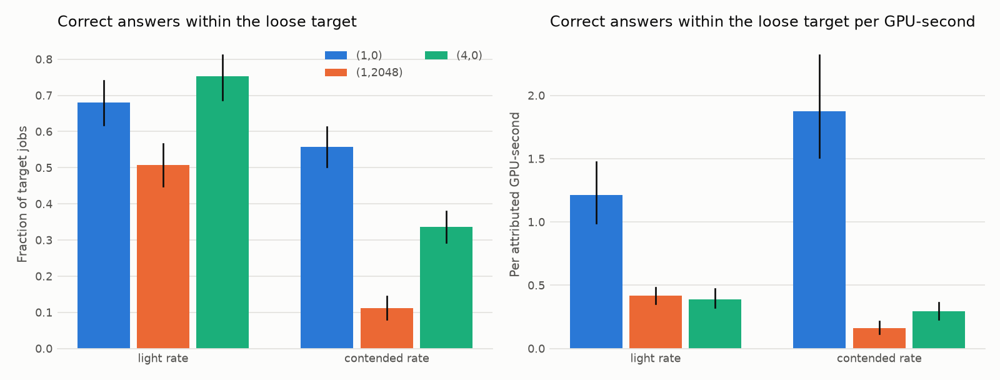

# Matched real answers on a 150-question representative cohort, RTX 4080 laptop, 2026-11-16

Hardware: HP Omen laptop, RTX 4080 Laptop GPU (12 GB), WSL2, vLLM 0.32.0, Qwen3-1.7B BF16. Results from other machines must not be pooled with these.

Generated by `16_make_baseline_report.py` from the logged run directories listed in `sources.json`. Every number below is formatted from a logged value; none is typed by hand.

## What was measured

- **Matched real-answer comparison:** real, graded answers to a fixed question cohort for each fixed action, next to matched synthetic background traffic at the background rates of each run.

## What was not measured

- No router or controller. Every action is fixed for a whole cell, so nothing here is a routing gain.
- Calibration and profiling use replayed lengths and score no answers.
- One machine and one server configuration. One pass per calibration rung and per profiling cell.
- Failures are kept in every denominator and listed by status; nothing was dropped.

## Figures

Matched real-answer comparison (matched-real-answers-4080-150q-20261115): correct answers within the loose latency target, as a fraction of target jobs and per attributed GPU-second. Black lines: 95% bootstrap intervals over questions.

## Tables

### Matched real-answer comparison

Source `/root/hpml-final-project/evaluation-results/matched-real-answers-4080-150q-20261115`, commit `38a0f4e`, status `complete`; blocks scored: 6, skipped: 0. Latency targets: tight 20.92 s, loose 41.84 s. Values are followed by 95% bootstrap intervals over questions.

| Rate | Action | Jobs | Seeds | Completed | No answer | Failed | Accuracy | Correct within tight | Correct within loose | Target GPU-s | Correct within tight per GPU-s | Correct within loose per GPU-s |
|---|---|---|---|---|---|---|---|---|---|---|---|---|
| light | (1,0) | 450 | 3 | 412 | 38 | 0 | 0.680 [0.613, 0.744] | 0.644 [0.580, 0.713] | 0.680 [0.618, 0.740] | 252 | 1.1491 [0.9230, 1.4118] | 1.2125 [0.9909, 1.4742] |
| light | (1,2048) | 450 | 3 | 450 | 0 | 0 | 0.776 [0.711, 0.836] | 0.129 [0.089, 0.171] | 0.507 [0.449, 0.567] | 547 | 0.1061 [0.0722, 0.1480] | 0.4171 [0.3555, 0.4837] |
| light | (4,0) | 450 | 3 | 436 | 14 | 0 | 0.778 [0.718, 0.833] | 0.633 [0.562, 0.700] | 0.753 [0.687, 0.811] | 869 | 0.3280 [0.2609, 0.4061] | 0.3901 [0.3222, 0.4704] |
| contended | (1,0) | 450 | 3 | 407 | 43 | 0 | 0.691 [0.627, 0.756] | 0.433 [0.380, 0.482] | 0.558 [0.502, 0.613] | 134 | 1.4556 [1.1754, 1.8180] | 1.8736 [1.5109, 2.3179] |
| contended | (1,2048) | 450 | 3 | 404 | 0 | 46 | 0.678 [0.618, 0.738] | 0.018 [0.007, 0.031] | 0.111 [0.080, 0.144] | 313 | 0.0255 [0.0094, 0.0454] | 0.1597 [0.1146, 0.2134] |
| contended | (4,0) | 450 | 3 | 436 | 14 | 0 | 0.762 [0.698, 0.822] | 0.173 [0.140, 0.209] | 0.336 [0.293, 0.380] | 517 | 0.1508 [0.1124, 0.1998] | 0.2919 [0.2315, 0.3642] |

Per cell:

| Block | Action | Target jobs | Correct | Correct within tight | Correct within loose | Target p95 (s) | Background requests | Background within tight | Background within loose | Background p95 (s) | Waiting max | KV cache max | Preemptions | GPU power mean (W) | Goodput tight per GPU-s | Goodput loose per GPU-s |
|---|---|---|---|---|---|---|---|---|---|---|---|---|---|---|---|---|
| seed-20261116-contended | control | 0 | 0 | 0 | 0 | - | 3031 | 111 | 3017 | 39.1 | 34 | 1.00 | 1655 | 88.5 | 0.086 | 2.328 |
| seed-20261116-contended | (1,2048) | 150 | 77 | 0 | 0 | 284.9 | 3031 | 0 | 77 | 212.7 | 461 | 1.00 | 5258 | 87.9 | 0.000 | 0.052 |
| seed-20261116-contended | (1,0) | 150 | 104 | 8 | 46 | 101.3 | 3031 | 0 | 139 | 86.7 | 190 | 1.00 | 4805 | 88.6 | 0.006 | 0.136 |
| seed-20261116-contended | (4,0) | 150 | 114 | 2 | 3 | 225.2 | 3031 | 0 | 45 | 214.5 | 527 | 1.00 | 5078 | 87.5 | 0.001 | 0.032 |
| seed-20261116-light | control | 0 | 0 | 0 | 0 | - | 1496 | 1398 | 1496 | 21.1 | 0 | 0.46 | 0 | 76.3 | 1.083 | 1.159 |
| seed-20261116-light | (1,0) | 150 | 106 | 99 | 106 | 40.1 | 1496 | 890 | 1496 | 23.8 | 0 | 0.51 | 0 | 73.2 | 0.764 | 1.238 |
| seed-20261116-light | (4,0) | 150 | 114 | 89 | 110 | 49.1 | 1496 | 426 | 1496 | 26.4 | 0 | 0.71 | 0 | 73.9 | 0.395 | 1.233 |
| seed-20261116-light | (1,2048) | 150 | 111 | 14 | 52 | 52.7 | 1496 | 258 | 1496 | 26.9 | 0 | 0.62 | 0 | 71.2 | 0.209 | 1.191 |
| seed-20261117-light | (1,2048) | 150 | 119 | 9 | 57 | 53.0 | 1568 | 171 | 1568 | 27.7 | 0 | 0.66 | 0 | 70.6 | 0.138 | 1.248 |
| seed-20261117-light | control | 0 | 0 | 0 | 0 | - | 1568 | 1004 | 1568 | 23.5 | 0 | 0.53 | 0 | 73.1 | 0.778 | 1.216 |
| seed-20261117-light | (4,0) | 150 | 116 | 90 | 109 | 53.6 | 1568 | 388 | 1568 | 28.2 | 0 | 0.75 | 0 | 74.9 | 0.367 | 1.287 |
| seed-20261117-light | (1,0) | 150 | 103 | 94 | 103 | 40.8 | 1568 | 917 | 1568 | 24.4 | 0 | 0.56 | 0 | 73.3 | 0.778 | 1.286 |
| seed-20261117-contended | control | 0 | 0 | 0 | 0 | - | 3098 | 1043 | 3047 | 39.6 | 47 | 1.00 | 834 | 110.2 | 0.806 | 2.355 |
| seed-20261117-contended | (4,0) | 150 | 115 | 27 | 58 | 98.8 | 3098 | 48 | 902 | 85.0 | 204 | 1.00 | 4163 | 114.8 | 0.055 | 0.709 |
| seed-20261117-contended | (1,2048) | 150 | 114 | 1 | 10 | 134.9 | 3098 | 57 | 1035 | 72.3 | 154 | 1.00 | 4106 | 114.6 | 0.043 | 0.774 |
| seed-20261117-contended | (1,0) | 150 | 101 | 91 | 99 | 44.5 | 3098 | 688 | 3098 | 29.3 | 18 | 1.00 | 79 | 114.9 | 0.600 | 2.463 |
| seed-20261118-light | (4,0) | 150 | 120 | 106 | 120 | 36.5 | 1506 | 1469 | 1506 | 20.0 | 0 | 0.70 | 0 | 114.9 | 1.213 | 1.252 |
| seed-20261118-light | control | 0 | 0 | 0 | 0 | - | 1506 | 1506 | 1506 | 15.5 | 0 | 0.36 | 0 | 114.9 | 1.169 | 1.169 |
| seed-20261118-light | (1,2048) | 150 | 119 | 35 | 119 | 34.0 | 1506 | 1506 | 1506 | 18.1 | 0 | 0.47 | 0 | 114.9 | 1.187 | 1.251 |
| seed-20261118-light | (1,0) | 150 | 97 | 97 | 97 | 29.3 | 1506 | 1506 | 1506 | 16.6 | 0 | 0.45 | 0 | 114.9 | 1.242 | 1.242 |
| seed-20261118-contended | (4,0) | 150 | 114 | 49 | 90 | 77.4 | 3028 | 223 | 1811 | 65.3 | 161 | 1.00 | 3384 | 114.8 | 0.202 | 1.413 |
| seed-20261118-contended | (1,0) | 150 | 106 | 96 | 106 | 48.1 | 3028 | 1011 | 3028 | 27.0 | 0 | 0.97 | 0 | 114.9 | 0.850 | 2.405 |
| seed-20261118-contended | (1,2048) | 150 | 114 | 7 | 40 | 66.3 | 3028 | 183 | 3016 | 36.5 | 59 | 1.00 | 1320 | 114.9 | 0.144 | 2.319 |
| seed-20261118-contended | control | 0 | 0 | 0 | 0 | - | 3028 | 1498 | 3028 | 23.5 | 0 | 0.83 | 0 | 114.9 | 1.158 | 2.340 |

Paired differences between actions at the same rate (first minus second):

| Rate | Metric | Action | Minus | Questions | Difference | 95% interval | Interval excludes zero |
|---|---|---|---|---|---|---|---|
| light | accuracy | (1,0) | (1,2048) | 150 | -0.0956 | [-0.1511, -0.0444] | yes |
| light | correct_within_loose | (1,0) | (1,2048) | 150 | +0.1733 | [+0.1200, +0.2222] | yes |
| light | correct_within_tight | (1,0) | (1,2048) | 150 | +0.5156 | [+0.4533, +0.5778] | yes |
| light | correct_within_loose_per_gpu_s | (1,0) | (1,2048) | 150 | +0.7954 | [+0.6081, +1.0230] | yes |
| light | correct_within_tight_per_gpu_s | (1,0) | (1,2048) | 150 | +1.0430 | [+0.8458, +1.2894] | yes |
| light | accuracy | (1,0) | (4,0) | 150 | -0.0978 | [-0.1356, -0.0600] | yes |
| light | correct_within_loose | (1,0) | (4,0) | 150 | -0.0733 | [-0.1111, -0.0400] | yes |
| light | correct_within_tight | (1,0) | (4,0) | 150 | +0.0111 | [-0.0200, +0.0422] | no |
| light | correct_within_loose_per_gpu_s | (1,0) | (4,0) | 150 | +0.8224 | [+0.6616, +1.0089] | yes |
| light | correct_within_tight_per_gpu_s | (1,0) | (4,0) | 150 | +0.8211 | [+0.6638, +1.0047] | yes |
| light | accuracy | (1,2048) | (4,0) | 150 | -0.0022 | [-0.0533, +0.0511] | no |
| light | correct_within_loose | (1,2048) | (4,0) | 150 | -0.2467 | [-0.2978, -0.1956] | yes |
| light | correct_within_tight | (1,2048) | (4,0) | 150 | -0.5044 | [-0.5711, -0.4422] | yes |
| light | correct_within_loose_per_gpu_s | (1,2048) | (4,0) | 150 | +0.0270 | [-0.0327, +0.0757] | no |
| light | correct_within_tight_per_gpu_s | (1,2048) | (4,0) | 150 | -0.2219 | [-0.2959, -0.1621] | yes |
| contended | accuracy | (1,0) | (1,2048) | 150 | +0.0133 | [-0.0400, +0.0667] | no |
| contended | correct_within_loose | (1,0) | (1,2048) | 150 | +0.4467 | [+0.3978, +0.4933] | yes |
| contended | correct_within_tight | (1,0) | (1,2048) | 150 | +0.4156 | [+0.3644, +0.4644] | yes |
| contended | correct_within_loose_per_gpu_s | (1,0) | (1,2048) | 150 | +1.7139 | [+1.3969, +2.1113] | yes |
| contended | correct_within_tight_per_gpu_s | (1,0) | (1,2048) | 150 | +1.4300 | [+1.1292, +1.7955] | yes |
| contended | accuracy | (1,0) | (4,0) | 150 | -0.0711 | [-0.1067, -0.0378] | yes |
| contended | correct_within_loose | (1,0) | (4,0) | 150 | +0.2222 | [+0.1822, +0.2622] | yes |
| contended | correct_within_tight | (1,0) | (4,0) | 150 | +0.2600 | [+0.2200, +0.3022] | yes |
| contended | correct_within_loose_per_gpu_s | (1,0) | (4,0) | 150 | +1.5817 | [+1.2785, +1.9540] | yes |
| contended | correct_within_tight_per_gpu_s | (1,0) | (4,0) | 150 | +1.3048 | [+1.0511, +1.6184] | yes |
| contended | accuracy | (1,2048) | (4,0) | 150 | -0.0844 | [-0.1356, -0.0311] | yes |
| contended | correct_within_loose | (1,2048) | (4,0) | 150 | -0.2244 | [-0.2644, -0.1867] | yes |
| contended | correct_within_tight | (1,2048) | (4,0) | 150 | -0.1556 | [-0.1867, -0.1244] | yes |
| contended | correct_within_loose_per_gpu_s | (1,2048) | (4,0) | 150 | -0.1322 | [-0.1954, -0.0769] | yes |
| contended | correct_within_tight_per_gpu_s | (1,2048) | (4,0) | 150 | -0.1252 | [-0.1700, -0.0883] | yes |

Definitions: **correct_within_target**: target job completed, majority answer verified correct, and job latency (scheduled arrival to last sample) within the target; every scheduled job is in the denominator. **per_gpu_s**: correct-within-target jobs divided by the GPU seconds attributed to target jobs: cell wall time (one GPU) times the job share of all tokens generated in the cell; prompt processing is not attributed separately. **goodput_per_gpu_s**: per cell: (target jobs correct within target + background requests completed within target) / cell wall seconds. **ci95**: percentile bootstrap, 2000 resamples of questions with replacement; seeds of a question are kept together; paired differences resample the same questions for both actions.
