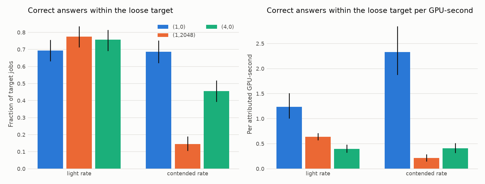

# Fixed actions on the 150-question representative cohort, three seeds at normal GPU power, RTX 4080 laptop, 2026-11-16

Hardware: HP Omen laptop, RTX 4080 Laptop GPU (12 GB), WSL2, vLLM 0.32.0, Qwen3-1.7B BF16. Results from other machines must not be pooled with these.

Generated by `16_make_baseline_report.py` from the logged run directories listed in `sources.json`. Every number below is formatted from a logged value; none is typed by hand.

## What was measured

- **Matched real-answer comparison:** real, graded answers to a fixed question cohort for each fixed action, next to matched synthetic background traffic at the background rates of each run.

## What was not measured

- No router or controller. Every action is fixed for a whole cell, so nothing here is a routing gain.
- Calibration and profiling use replayed lengths and score no answers.
- One machine and one server configuration. One pass per calibration rung and per profiling cell.
- Failures are kept in every denominator and listed by status; nothing was dropped.

## Figures

Matched real-answer comparison (matched-real-answers-4080-150q-assembled-20261116): correct answers within the loose latency target, as a fraction of target jobs and per attributed GPU-second. Black lines: 95% bootstrap intervals over questions.

## Tables

### Matched real-answer comparison

Source `/root/hpml-final-project/evaluation-results/matched-real-answers-4080-150q-assembled-20261116`, commit `2473f46`, status `complete`; blocks scored: 6, skipped: 0. Latency targets: tight 20.92 s, loose 41.84 s. Values are followed by 95% bootstrap intervals over questions.

| Rate | Action | Jobs | Seeds | Completed | No answer | Failed | Accuracy | Correct within tight | Correct within loose | Target GPU-s | Correct within tight per GPU-s | Correct within loose per GPU-s |
|---|---|---|---|---|---|---|---|---|---|---|---|---|
| light | (1,0) | 450 | 3 | 409 | 41 | 0 | 0.693 [0.627, 0.756] | 0.684 [0.618, 0.749] | 0.693 [0.633, 0.753] | 252 | 1.2221 [0.9934, 1.4836] | 1.2380 [1.0146, 1.5017] |
| light | (1,2048) | 450 | 3 | 450 | 0 | 0 | 0.776 [0.711, 0.836] | 0.216 [0.162, 0.276] | 0.776 [0.716, 0.833] | 545 | 0.1780 [0.1300, 0.2358] | 0.6404 [0.5748, 0.7071] |
| light | (4,0) | 450 | 3 | 437 | 13 | 0 | 0.758 [0.696, 0.816] | 0.671 [0.604, 0.738] | 0.758 [0.693, 0.813] | 857 | 0.3525 [0.2853, 0.4328] | 0.3980 [0.3296, 0.4763] |
| contended | (1,0) | 450 | 3 | 407 | 43 | 0 | 0.693 [0.629, 0.753] | 0.587 [0.513, 0.653] | 0.687 [0.622, 0.751] | 133 | 1.9914 [1.5985, 2.4760] | 2.3308 [1.8806, 2.8365] |
| contended | (1,2048) | 450 | 3 | 450 | 0 | 0 | 0.751 [0.687, 0.811] | 0.016 [0.004, 0.027] | 0.144 [0.107, 0.187] | 304 | 0.0230 [0.0094, 0.0430] | 0.2135 [0.1551, 0.2812] |
| contended | (4,0) | 450 | 3 | 436 | 14 | 0 | 0.756 [0.691, 0.813] | 0.202 [0.162, 0.244] | 0.456 [0.396, 0.516] | 502 | 0.1811 [0.1331, 0.2436] | 0.4081 [0.3208, 0.5077] |

Per cell:

| Block | Action | Target jobs | Correct | Correct within tight | Correct within loose | Target p95 (s) | Background requests | Background within tight | Background within loose | Background p95 (s) | Waiting max | KV cache max | Preemptions | GPU power mean (W) | Goodput tight per GPU-s | Goodput loose per GPU-s |
|---|---|---|---|---|---|---|---|---|---|---|---|---|---|---|---|---|
| seed-20261118-light | (4,0) | 150 | 120 | 106 | 120 | 36.5 | 1506 | 1469 | 1506 | 20.0 | 0 | 0.70 | 0 | 114.9 | 1.213 | 1.252 |
| seed-20261118-light | control | 0 | 0 | 0 | 0 | - | 1506 | 1506 | 1506 | 15.5 | 0 | 0.36 | 0 | 114.9 | 1.169 | 1.169 |
| seed-20261118-light | (1,2048) | 150 | 119 | 35 | 119 | 34.0 | 1506 | 1506 | 1506 | 18.1 | 0 | 0.47 | 0 | 114.9 | 1.187 | 1.251 |
| seed-20261118-light | (1,0) | 150 | 97 | 97 | 97 | 29.3 | 1506 | 1506 | 1506 | 16.6 | 0 | 0.45 | 0 | 114.9 | 1.242 | 1.242 |
| seed-20261118-contended | (4,0) | 150 | 114 | 49 | 90 | 77.4 | 3028 | 223 | 1811 | 65.3 | 161 | 1.00 | 3384 | 114.8 | 0.202 | 1.413 |
| seed-20261118-contended | (1,0) | 150 | 106 | 96 | 106 | 48.1 | 3028 | 1011 | 3028 | 27.0 | 0 | 0.97 | 0 | 114.9 | 0.850 | 2.405 |
| seed-20261118-contended | (1,2048) | 150 | 114 | 7 | 40 | 66.3 | 3028 | 183 | 3016 | 36.5 | 59 | 1.00 | 1320 | 114.9 | 0.144 | 2.319 |
| seed-20261118-contended | control | 0 | 0 | 0 | 0 | - | 3028 | 1498 | 3028 | 23.5 | 0 | 0.83 | 0 | 114.9 | 1.158 | 2.340 |
| seed-20261116-light | control | 0 | 0 | 0 | 0 | - | 1496 | 1496 | 1496 | 16.0 | 0 | 0.34 | 0 | 102.5 | 1.161 | 1.161 |
| seed-20261116-light | (1,0) | 150 | 108 | 105 | 108 | 29.4 | 1496 | 1496 | 1496 | 16.6 | 0 | 0.38 | 0 | 102.8 | 1.238 | 1.241 |
| seed-20261116-light | (4,0) | 150 | 111 | 98 | 111 | 34.0 | 1496 | 1496 | 1496 | 18.6 | 0 | 0.51 | 0 | 112.8 | 1.232 | 1.242 |
| seed-20261116-light | (1,2048) | 150 | 112 | 31 | 112 | 35.2 | 1496 | 1496 | 1496 | 18.2 | 0 | 0.47 | 0 | 104.0 | 1.181 | 1.243 |
| seed-20261116-contended | control | 0 | 0 | 0 | 0 | - | 3031 | 1324 | 3031 | 26.7 | 0 | 0.89 | 0 | 112.9 | 1.025 | 2.346 |
| seed-20261116-contended | (1,2048) | 150 | 108 | 0 | 19 | 110.6 | 3031 | 63 | 1770 | 63.0 | 122 | 1.00 | 3768 | 114.6 | 0.047 | 1.342 |
| seed-20261116-contended | (1,0) | 150 | 107 | 94 | 106 | 50.4 | 3031 | 483 | 3031 | 32.7 | 21 | 1.00 | 310 | 113.0 | 0.445 | 2.419 |
| seed-20261116-contended | (4,0) | 150 | 110 | 16 | 60 | 90.4 | 3031 | 12 | 616 | 72.5 | 172 | 1.00 | 5314 | 111.6 | 0.021 | 0.502 |
| seed-20261117-light | (1,2048) | 150 | 118 | 31 | 118 | 35.5 | 1568 | 1568 | 1568 | 18.4 | 0 | 0.51 | 0 | 112.8 | 1.230 | 1.297 |
| seed-20261117-light | control | 0 | 0 | 0 | 0 | - | 1568 | 1568 | 1568 | 16.4 | 0 | 0.41 | 0 | 104.6 | 1.221 | 1.221 |
| seed-20261117-light | (4,0) | 150 | 110 | 98 | 110 | 35.1 | 1568 | 1568 | 1568 | 18.7 | 0 | 0.54 | 0 | - | 1.284 | 1.293 |
| seed-20261117-light | (1,0) | 150 | 107 | 106 | 107 | 30.3 | 1568 | 1568 | 1568 | 16.8 | 0 | 0.45 | 0 | 105.2 | 1.295 | 1.296 |
| seed-20261117-contended | control | 0 | 0 | 0 | 0 | - | 3098 | 1279 | 3098 | 26.8 | 0 | 0.94 | 0 | 112.2 | 0.989 | 2.394 |
| seed-20261117-contended | (4,0) | 150 | 116 | 26 | 55 | 110.8 | 3098 | 48 | 935 | 104.1 | 262 | 1.00 | 4187 | - | 0.054 | 0.718 |
| seed-20261117-contended | (1,2048) | 150 | 116 | 0 | 6 | 231.6 | 3098 | 20 | 678 | 130.3 | 299 | 1.00 | 4974 | - | 0.014 | 0.485 |
| seed-20261117-contended | (1,0) | 150 | 99 | 74 | 97 | 54.8 | 3098 | 143 | 2917 | 42.1 | 68 | 1.00 | 2089 | - | 0.166 | 2.311 |

Paired differences between actions at the same rate (first minus second):

| Rate | Metric | Action | Minus | Questions | Difference | 95% interval | Interval excludes zero |
|---|---|---|---|---|---|---|---|
| light | accuracy | (1,0) | (1,2048) | 150 | -0.0822 | [-0.1356, -0.0311] | yes |
| light | correct_within_loose | (1,0) | (1,2048) | 150 | -0.0822 | [-0.1333, -0.0333] | yes |
| light | correct_within_tight | (1,0) | (1,2048) | 150 | +0.4689 | [+0.4044, +0.5333] | yes |
| light | correct_within_loose_per_gpu_s | (1,0) | (1,2048) | 150 | +0.5976 | [+0.4166, +0.8068] | yes |
| light | correct_within_tight_per_gpu_s | (1,0) | (1,2048) | 150 | +1.0441 | [+0.8518, +1.2823] | yes |
| light | accuracy | (1,0) | (4,0) | 150 | -0.0644 | [-0.0956, -0.0289] | yes |
| light | correct_within_loose | (1,0) | (4,0) | 150 | -0.0644 | [-0.1000, -0.0311] | yes |
| light | correct_within_tight | (1,0) | (4,0) | 150 | +0.0133 | [-0.0222, +0.0556] | no |
| light | correct_within_loose_per_gpu_s | (1,0) | (4,0) | 150 | +0.8400 | [+0.6843, +1.0341] | yes |
| light | correct_within_tight_per_gpu_s | (1,0) | (4,0) | 150 | +0.8696 | [+0.7092, +1.0502] | yes |
| light | accuracy | (1,2048) | (4,0) | 150 | +0.0178 | [-0.0311, +0.0711] | no |
| light | correct_within_loose | (1,2048) | (4,0) | 150 | +0.0178 | [-0.0333, +0.0689] | no |
| light | correct_within_tight | (1,2048) | (4,0) | 150 | -0.4556 | [-0.5244, -0.3933] | yes |
| light | correct_within_loose_per_gpu_s | (1,2048) | (4,0) | 150 | +0.2424 | [+0.1935, +0.2842] | yes |
| light | correct_within_tight_per_gpu_s | (1,2048) | (4,0) | 150 | -0.1745 | [-0.2487, -0.1136] | yes |
| contended | accuracy | (1,0) | (1,2048) | 150 | -0.0578 | [-0.1156, +0.0000] | no |
| contended | correct_within_loose | (1,0) | (1,2048) | 150 | +0.5422 | [+0.4822, +0.6022] | yes |
| contended | correct_within_tight | (1,0) | (1,2048) | 150 | +0.5711 | [+0.5022, +0.6400] | yes |
| contended | correct_within_loose_per_gpu_s | (1,0) | (1,2048) | 150 | +2.1173 | [+1.7430, +2.5828] | yes |
| contended | correct_within_tight_per_gpu_s | (1,0) | (1,2048) | 150 | +1.9684 | [+1.5701, +2.4770] | yes |
| contended | accuracy | (1,0) | (4,0) | 150 | -0.0622 | [-0.0933, -0.0311] | yes |
| contended | correct_within_loose | (1,0) | (4,0) | 150 | +0.2311 | [+0.1844, +0.2756] | yes |
| contended | correct_within_tight | (1,0) | (4,0) | 150 | +0.3844 | [+0.3333, +0.4378] | yes |
| contended | correct_within_loose_per_gpu_s | (1,0) | (4,0) | 150 | +1.9227 | [+1.5963, +2.3301] | yes |
| contended | correct_within_tight_per_gpu_s | (1,0) | (4,0) | 150 | +1.8102 | [+1.4593, +2.2396] | yes |
| contended | accuracy | (1,2048) | (4,0) | 150 | -0.0044 | [-0.0578, +0.0467] | no |
| contended | correct_within_loose | (1,2048) | (4,0) | 150 | -0.3111 | [-0.3578, -0.2622] | yes |
| contended | correct_within_tight | (1,2048) | (4,0) | 150 | -0.1867 | [-0.2267, -0.1489] | yes |
| contended | correct_within_loose_per_gpu_s | (1,2048) | (4,0) | 150 | -0.1946 | [-0.2807, -0.1190] | yes |
| contended | correct_within_tight_per_gpu_s | (1,2048) | (4,0) | 150 | -0.1582 | [-0.2166, -0.1133] | yes |

Definitions: **correct_within_target**: target job completed, majority answer verified correct, and job latency (scheduled arrival to last sample) within the target; every scheduled job is in the denominator. **per_gpu_s**: correct-within-target jobs divided by the GPU seconds attributed to target jobs: cell wall time (one GPU) times the job share of all tokens generated in the cell; prompt processing is not attributed separately. **goodput_per_gpu_s**: per cell: (target jobs correct within target + background requests completed within target) / cell wall seconds. **ci95**: percentile bootstrap, 2000 resamples of questions with replacement; seeds of a question are kept together; paired differences resample the same questions for both actions.
