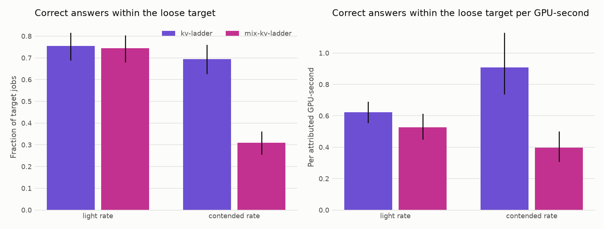

# Load-adaptive controller against matched-power fixed actions on the 150-question cohort, three seeds, RTX 4080 laptop, 2026-11-22

Hardware: HP Omen laptop, RTX 4080 Laptop GPU (12 GB), WSL2, vLLM 0.32.0, Qwen3-1.7B BF16. Results from other machines must not be pooled with these.

Generated by `16_make_baseline_report.py` from the logged run directories listed in `sources.json`. Every number below is formatted from a logged value; none is typed by hand.

## What was measured

- **Matched real-answer comparison:** real, graded answers to a fixed question cohort for each fixed action, next to matched synthetic background traffic at the background rates of each run.
- **Per-job policies** (`kv-ladder`, `mix-kv-ladder`): an action chosen per target job by a rule frozen before the run, from a server signal read at arrival or from a fixed hash of the job. The chosen actions are listed per entry.

## What was not measured

- No learned router. A policy is a gain over a fixed action only where a paired interval against that action excludes zero; fixed-action cells keep one action for the whole cell.
- Calibration and profiling use replayed lengths and score no answers.
- One machine and one server configuration. One pass per calibration rung and per profiling cell.
- Failures are kept in every denominator and listed by status; nothing was dropped.

## Figures

Matched real-answer comparison (matched-real-answers-4080-150q-fixed-matched-power-assembled-20261122): correct answers within the loose latency target, as a fraction of target jobs and per attributed GPU-second. Black lines: 95% bootstrap intervals over questions.

Matched real-answer comparison (matched-real-answers-4080-150q-policies-assembled-20261121): correct answers within the loose latency target, as a fraction of target jobs and per attributed GPU-second. Black lines: 95% bootstrap intervals over questions.

## Tables

### Matched real-answer comparison

Source `/root/hpml-final-project/evaluation-results/matched-real-answers-4080-150q-fixed-matched-power-assembled-20261122`, commit `d1df19b`, status `complete`; blocks scored: 6, skipped: 0. Latency targets: tight 20.92 s, loose 41.84 s. Values are followed by 95% bootstrap intervals over questions.

| Rate | Action | Chosen actions | Jobs | Seeds | Completed | No answer | Failed | Accuracy | Correct within tight | Correct within loose | Target GPU-s | Correct within tight per GPU-s | Correct within loose per GPU-s |
|---|---|---|---|---|---|---|---|---|---|---|---|---|---|
| light | (1,0) | - | 450 | 3 | 408 | 42 | 0 | 0.700 [0.633, 0.760] | 0.676 [0.611, 0.742] | 0.700 [0.638, 0.758] | 257 | 1.1846 [0.9606, 1.4493] | 1.2274 [1.0111, 1.4850] |
| light | (1,2048) | - | 450 | 3 | 450 | 0 | 0 | 0.767 [0.704, 0.824] | 0.189 [0.138, 0.244] | 0.767 [0.704, 0.824] | 545 | 0.1558 [0.1095, 0.2101] | 0.6325 [0.5702, 0.6993] |
| light | (4,0) | - | 450 | 3 | 438 | 12 | 0 | 0.742 [0.676, 0.802] | 0.651 [0.580, 0.720] | 0.742 [0.676, 0.804] | 857 | 0.3418 [0.2756, 0.4208] | 0.3896 [0.3222, 0.4689] |
| contended | (1,0) | - | 450 | 3 | 403 | 47 | 0 | 0.687 [0.620, 0.747] | 0.622 [0.547, 0.691] | 0.684 [0.624, 0.749] | 134 | 2.0882 [1.6842, 2.5784] | 2.2970 [1.8504, 2.7908] |
| contended | (1,2048) | - | 450 | 3 | 450 | 0 | 0 | 0.751 [0.689, 0.811] | 0.027 [0.011, 0.042] | 0.191 [0.149, 0.238] | 297 | 0.0404 [0.0194, 0.0674] | 0.2892 [0.2206, 0.3710] |
| contended | (4,0) | - | 450 | 3 | 437 | 13 | 0 | 0.749 [0.684, 0.807] | 0.240 [0.193, 0.284] | 0.520 [0.453, 0.584] | 492 | 0.2196 [0.1635, 0.2907] | 0.4757 [0.3725, 0.5892] |

Per cell:

| Block | Action | Target jobs | Correct | Correct within tight | Correct within loose | Target p95 (s) | Background requests | Background within tight | Background within loose | Background p95 (s) | Waiting max | KV cache max | Preemptions | GPU power mean (W) | Goodput tight per GPU-s | Goodput loose per GPU-s |
|---|---|---|---|---|---|---|---|---|---|---|---|---|---|---|---|---|
| seed-20261116-light | control | 0 | 0 | 0 | 0 | - | 1496 | 1496 | 1496 | 16.0 | 0 | 0.34 | 0 | 102.5 | 1.161 | 1.161 |
| seed-20261116-light | (1,0) | 150 | 108 | 105 | 108 | 29.4 | 1496 | 1496 | 1496 | 16.6 | 0 | 0.38 | 0 | 102.8 | 1.238 | 1.241 |
| seed-20261116-light | (4,0) | 150 | 111 | 98 | 111 | 34.0 | 1496 | 1496 | 1496 | 18.6 | 0 | 0.51 | 0 | 112.8 | 1.232 | 1.242 |
| seed-20261116-light | (1,2048) | 150 | 112 | 31 | 112 | 35.2 | 1496 | 1496 | 1496 | 18.2 | 0 | 0.47 | 0 | 104.0 | 1.181 | 1.243 |
| seed-20261116-contended | control | 0 | 0 | 0 | 0 | - | 3031 | 1324 | 3031 | 26.7 | 0 | 0.89 | 0 | 112.9 | 1.025 | 2.346 |
| seed-20261116-contended | (1,2048) | 150 | 108 | 0 | 19 | 110.6 | 3031 | 63 | 1770 | 63.0 | 122 | 1.00 | 3768 | 114.6 | 0.047 | 1.342 |
| seed-20261116-contended | (1,0) | 150 | 107 | 94 | 106 | 50.4 | 3031 | 483 | 3031 | 32.7 | 21 | 1.00 | 310 | 113.0 | 0.445 | 2.419 |
| seed-20261116-contended | (4,0) | 150 | 110 | 16 | 60 | 90.4 | 3031 | 12 | 616 | 72.5 | 172 | 1.00 | 5314 | 111.6 | 0.021 | 0.502 |
| seed-20261117-light | (1,2048) | 150 | 117 | 28 | 117 | 37.4 | 1568 | 1566 | 1568 | 19.8 | 0 | 0.52 | 0 | 100.5 | 1.226 | 1.296 |
| seed-20261117-light | control | 0 | 0 | 0 | 0 | - | 1568 | 1568 | 1568 | 16.9 | 0 | 0.41 | 0 | 101.2 | 1.221 | 1.221 |
| seed-20261117-light | (4,0) | 150 | 114 | 96 | 114 | 34.8 | 1568 | 1568 | 1568 | 18.8 | 0 | 0.54 | 0 | 115.0 | 1.283 | 1.297 |
| seed-20261117-light | (1,0) | 150 | 106 | 101 | 106 | 29.3 | 1568 | 1568 | 1568 | 16.6 | 0 | 0.43 | 0 | 115.7 | 1.292 | 1.296 |
| seed-20261117-contended | control | 0 | 0 | 0 | 0 | - | 3098 | 1996 | 3098 | 25.5 | 0 | 0.90 | 0 | 124.8 | 1.542 | 2.394 |
| seed-20261117-contended | (4,0) | 150 | 113 | 28 | 73 | 85.3 | 3098 | 64 | 1133 | 66.3 | 155 | 1.00 | 4745 | 122.4 | 0.069 | 0.905 |
| seed-20261117-contended | (1,2048) | 150 | 112 | 1 | 18 | 102.4 | 3098 | 89 | 1609 | 59.9 | 120 | 1.00 | 3207 | 122.6 | 0.067 | 1.220 |
| seed-20261117-contended | (1,0) | 150 | 101 | 91 | 101 | 47.3 | 3098 | 1086 | 3098 | 27.9 | 5 | 1.00 | 38 | 122.0 | 0.906 | 2.462 |
| seed-20261118-light | (4,0) | 150 | 109 | 99 | 109 | 37.5 | 1506 | 1452 | 1506 | 20.6 | 0 | 0.70 | 0 | 117.1 | 1.194 | 1.243 |
| seed-20261118-light | control | 0 | 0 | 0 | 0 | - | 1506 | 1506 | 1506 | 16.9 | 0 | 0.37 | 0 | 93.8 | 1.168 | 1.168 |
| seed-20261118-light | (1,2048) | 150 | 116 | 26 | 116 | 38.3 | 1506 | 1473 | 1506 | 20.4 | 0 | 0.51 | 0 | 91.3 | 1.153 | 1.248 |
| seed-20261118-light | (1,0) | 150 | 101 | 98 | 101 | 32.4 | 1506 | 1506 | 1506 | 18.3 | 0 | 0.46 | 0 | 91.0 | 1.237 | 1.239 |
| seed-20261118-contended | (4,0) | 150 | 114 | 64 | 101 | 67.4 | 3028 | 284 | 2438 | 52.1 | 118 | 1.00 | 2923 | 120.8 | 0.262 | 1.912 |
| seed-20261118-contended | (1,0) | 150 | 101 | 95 | 101 | 47.7 | 3028 | 1202 | 3028 | 26.5 | 0 | 0.98 | 0 | 121.1 | 0.996 | 2.403 |
| seed-20261118-contended | (1,2048) | 150 | 118 | 11 | 49 | 60.0 | 3028 | 287 | 3028 | 30.4 | 31 | 1.00 | 457 | 121.9 | 0.228 | 2.354 |
| seed-20261118-contended | control | 0 | 0 | 0 | 0 | - | 3028 | 1869 | 3028 | 22.7 | 0 | 0.82 | 0 | 122.7 | 1.445 | 2.342 |

Paired differences between actions at the same rate (first minus second):

| Rate | Metric | Action | Minus | Questions | Difference | 95% interval | Interval excludes zero |
|---|---|---|---|---|---|---|---|
| light | accuracy | (1,0) | (1,2048) | 150 | -0.0667 | [-0.1200, -0.0133] | yes |
| light | correct_within_loose | (1,0) | (1,2048) | 150 | -0.0667 | [-0.1222, -0.0156] | yes |
| light | correct_within_tight | (1,0) | (1,2048) | 150 | +0.4867 | [+0.4200, +0.5511] | yes |
| light | correct_within_loose_per_gpu_s | (1,0) | (1,2048) | 150 | +0.5949 | [+0.4204, +0.7968] | yes |
| light | correct_within_tight_per_gpu_s | (1,0) | (1,2048) | 150 | +1.0287 | [+0.8374, +1.2727] | yes |
| light | accuracy | (1,0) | (4,0) | 150 | -0.0422 | [-0.0756, -0.0067] | yes |
| light | correct_within_loose | (1,0) | (4,0) | 150 | -0.0422 | [-0.0778, -0.0067] | yes |
| light | correct_within_tight | (1,0) | (4,0) | 150 | +0.0244 | [-0.0133, +0.0622] | no |
| light | correct_within_loose_per_gpu_s | (1,0) | (4,0) | 150 | +0.8378 | [+0.6869, +1.0237] | yes |
| light | correct_within_tight_per_gpu_s | (1,0) | (4,0) | 150 | +0.8428 | [+0.6820, +1.0184] | yes |
| light | accuracy | (1,2048) | (4,0) | 150 | +0.0244 | [-0.0311, +0.0844] | no |
| light | correct_within_loose | (1,2048) | (4,0) | 150 | +0.0244 | [-0.0356, +0.0822] | no |
| light | correct_within_tight | (1,2048) | (4,0) | 150 | -0.4622 | [-0.5311, -0.3956] | yes |
| light | correct_within_loose_per_gpu_s | (1,2048) | (4,0) | 150 | +0.2429 | [+0.1904, +0.2916] | yes |
| light | correct_within_tight_per_gpu_s | (1,2048) | (4,0) | 150 | -0.1859 | [-0.2635, -0.1222] | yes |
| contended | accuracy | (1,0) | (1,2048) | 150 | -0.0644 | [-0.1156, -0.0111] | yes |
| contended | correct_within_loose | (1,0) | (1,2048) | 150 | +0.4933 | [+0.4333, +0.5533] | yes |
| contended | correct_within_tight | (1,0) | (1,2048) | 150 | +0.5956 | [+0.5289, +0.6622] | yes |
| contended | correct_within_loose_per_gpu_s | (1,0) | (1,2048) | 150 | +2.0078 | [+1.6380, +2.4695] | yes |
| contended | correct_within_tight_per_gpu_s | (1,0) | (1,2048) | 150 | +2.0478 | [+1.6403, +2.5535] | yes |
| contended | accuracy | (1,0) | (4,0) | 150 | -0.0622 | [-0.0956, -0.0311] | yes |
| contended | correct_within_loose | (1,0) | (4,0) | 150 | +0.1644 | [+0.1200, +0.2111] | yes |
| contended | correct_within_tight | (1,0) | (4,0) | 150 | +0.3822 | [+0.3267, +0.4400] | yes |
| contended | correct_within_loose_per_gpu_s | (1,0) | (4,0) | 150 | +1.8213 | [+1.4990, +2.2198] | yes |
| contended | correct_within_tight_per_gpu_s | (1,0) | (4,0) | 150 | +1.8686 | [+1.5118, +2.2969] | yes |
| contended | accuracy | (1,2048) | (4,0) | 150 | +0.0022 | [-0.0444, +0.0489] | no |
| contended | correct_within_loose | (1,2048) | (4,0) | 150 | -0.3289 | [-0.3800, -0.2778] | yes |
| contended | correct_within_tight | (1,2048) | (4,0) | 150 | -0.2133 | [-0.2578, -0.1733] | yes |
| contended | correct_within_loose_per_gpu_s | (1,2048) | (4,0) | 150 | -0.1865 | [-0.2840, -0.1052] | yes |
| contended | correct_within_tight_per_gpu_s | (1,2048) | (4,0) | 150 | -0.1792 | [-0.2445, -0.1264] | yes |

Definitions: **correct_within_target**: target job completed, majority answer verified correct, and job latency (scheduled arrival to last sample) within the target; every scheduled job is in the denominator. **per_gpu_s**: correct-within-target jobs divided by the GPU seconds attributed to target jobs: cell wall time (one GPU) times the job share of all tokens generated in the cell; prompt processing is not attributed separately. **goodput_per_gpu_s**: per cell: (target jobs correct within target + background requests completed within target) / cell wall seconds. **ci95**: percentile bootstrap, 2000 resamples of questions with replacement; seeds of a question are kept together; paired differences resample the same questions for both actions.

### Matched real-answer comparison (matched-real-answers-4080-150q-policies-assembled-20261121)

Source `/root/hpml-final-project/evaluation-results/matched-real-answers-4080-150q-policies-assembled-20261121`, commit `d1df19b`, status `complete`; blocks scored: 6, skipped: 0. Latency targets: tight 20.92 s, loose 41.84 s. Values are followed by 95% bootstrap intervals over questions.

| Rate | Action | Chosen actions | Jobs | Seeds | Completed | No answer | Failed | Accuracy | Correct within tight | Correct within loose | Target GPU-s | Correct within tight per GPU-s | Correct within loose per GPU-s |
|---|---|---|---|---|---|---|---|---|---|---|---|---|---|
| light | kv-ladder | 1:2048 450 | 450 | 3 | 450 | 0 | 0 | 0.756 [0.691, 0.816] | 0.211 [0.156, 0.269] | 0.756 [0.691, 0.813] | 546 | 0.1739 [0.1238, 0.2309] | 0.6222 [0.5575, 0.6885] |
| light | mix-kv-ladder | 1:0 36, 1:2048 266, 4:0 148 | 450 | 3 | 439 | 11 | 0 | 0.744 [0.680, 0.804] | 0.378 [0.320, 0.438] | 0.744 [0.682, 0.802] | 635 | 0.2678 [0.2100, 0.3284] | 0.5277 [0.4517, 0.6111] |
| contended | kv-ladder | 1:0 176, 1:2048 23, 4:0 251 | 450 | 3 | 432 | 18 | 0 | 0.744 [0.684, 0.802] | 0.553 [0.480, 0.620] | 0.693 [0.629, 0.758] | 344 | 0.7248 [0.5690, 0.9103] | 0.9082 [0.7392, 1.1260] |
| contended | mix-kv-ladder | 1:0 36, 1:2048 266, 4:0 148 | 450 | 3 | 443 | 7 | 0 | 0.753 [0.696, 0.809] | 0.138 [0.104, 0.173] | 0.309 [0.258, 0.360] | 351 | 0.1768 [0.1235, 0.2335] | 0.3965 [0.3107, 0.4968] |

Per cell:

| Block | Action | Target jobs | Correct | Correct within tight | Correct within loose | Target p95 (s) | Background requests | Background within tight | Background within loose | Background p95 (s) | Waiting max | KV cache max | Preemptions | GPU power mean (W) | Goodput tight per GPU-s | Goodput loose per GPU-s |
|---|---|---|---|---|---|---|---|---|---|---|---|---|---|---|---|---|
| seed-20261116-light | control | 0 | 0 | 0 | 0 | - | 1496 | 1496 | 1496 | 15.9 | 0 | 0.38 | 0 | - | 1.161 | 1.161 |
| seed-20261116-light | kv-ladder | 150 | 114 | 31 | 114 | 34.9 | 1496 | 1496 | 1496 | 18.2 | 0 | 0.46 | 0 | 104.5 | 1.180 | 1.245 |
| seed-20261116-light | mix-kv-ladder | 150 | 113 | 59 | 113 | 35.3 | 1496 | 1492 | 1496 | 19.3 | 0 | 0.54 | 0 | 103.3 | 1.199 | 1.244 |
| seed-20261116-contended | control | 0 | 0 | 0 | 0 | - | 3031 | 1434 | 3031 | 26.2 | 0 | 0.88 | 0 | 107.1 | 1.110 | 2.346 |
| seed-20261116-contended | mix-kv-ladder | 150 | 110 | 3 | 22 | 168.0 | 3031 | 29 | 417 | 97.6 | 215 | 1.00 | 4976 | - | 0.023 | 0.319 |
| seed-20261116-contended | kv-ladder | 150 | 110 | 81 | 102 | 62.3 | 3031 | 152 | 2881 | 41.8 | 59 | 1.00 | 2552 | - | 0.179 | 2.293 |
| seed-20261117-light | kv-ladder | 150 | 113 | 27 | 113 | 34.8 | 1568 | 1568 | 1568 | 18.2 | 0 | 0.51 | 0 | 126.5 | 1.233 | 1.299 |
| seed-20261117-light | mix-kv-ladder | 150 | 107 | 61 | 107 | 34.0 | 1568 | 1568 | 1568 | 17.8 | 0 | 0.48 | 0 | 123.5 | 1.254 | 1.289 |
| seed-20261117-light | control | 0 | 0 | 0 | 0 | - | 1568 | 1568 | 1568 | 15.7 | 0 | 0.40 | 0 | 124.1 | 1.220 | 1.220 |
| seed-20261117-contended | mix-kv-ladder | 150 | 110 | 23 | 53 | 81.0 | 3098 | 106 | 2394 | 48.7 | 100 | 1.00 | 3252 | 122.7 | 0.098 | 1.859 |
| seed-20261117-contended | kv-ladder | 150 | 113 | 82 | 105 | 55.0 | 3098 | 347 | 3098 | 31.6 | 34 | 1.00 | 846 | 122.8 | 0.329 | 2.455 |
| seed-20261117-contended | control | 0 | 0 | 0 | 0 | - | 3098 | 1900 | 3098 | 25.6 | 0 | 0.90 | 0 | 123.0 | 1.468 | 2.394 |
| seed-20261118-light | kv-ladder | 150 | 113 | 37 | 113 | 34.0 | 1506 | 1506 | 1506 | 17.8 | 0 | 0.47 | 0 | 124.0 | 1.189 | 1.247 |
| seed-20261118-light | control | 0 | 0 | 0 | 0 | - | 1506 | 1506 | 1506 | 15.4 | 0 | 0.36 | 0 | 124.4 | 1.168 | 1.168 |
| seed-20261118-light | mix-kv-ladder | 150 | 115 | 50 | 115 | 34.9 | 1506 | 1506 | 1506 | 18.2 | 0 | 0.59 | 0 | 123.2 | 1.199 | 1.249 |
| seed-20261118-contended | kv-ladder | 150 | 112 | 86 | 105 | 54.7 | 3028 | 546 | 3028 | 29.4 | 27 | 1.00 | 352 | 121.6 | 0.484 | 2.398 |
| seed-20261118-contended | control | 0 | 0 | 0 | 0 | - | 3028 | 1824 | 3028 | 22.9 | 0 | 0.81 | 0 | 122.6 | 1.410 | 2.341 |
| seed-20261118-contended | mix-kv-ladder | 150 | 119 | 36 | 64 | 59.9 | 3028 | 306 | 3017 | 35.3 | 65 | 1.00 | 1119 | 122.6 | 0.260 | 2.340 |

Paired differences between actions at the same rate (first minus second):

| Rate | Metric | Action | Minus | Questions | Difference | 95% interval | Interval excludes zero |
|---|---|---|---|---|---|---|---|
| light | accuracy | kv-ladder | mix-kv-ladder | 150 | +0.0111 | [-0.0222, +0.0422] | no |
| light | correct_within_loose | kv-ladder | mix-kv-ladder | 150 | +0.0111 | [-0.0222, +0.0444] | no |
| light | correct_within_tight | kv-ladder | mix-kv-ladder | 150 | -0.1667 | [-0.2133, -0.1244] | yes |
| light | correct_within_loose_per_gpu_s | kv-ladder | mix-kv-ladder | 150 | +0.0945 | [+0.0493, +0.1365] | yes |
| light | correct_within_tight_per_gpu_s | kv-ladder | mix-kv-ladder | 150 | -0.0939 | [-0.1366, -0.0525] | yes |
| contended | accuracy | kv-ladder | mix-kv-ladder | 150 | -0.0089 | [-0.0511, +0.0311] | no |
| contended | correct_within_loose | kv-ladder | mix-kv-ladder | 150 | +0.3844 | [+0.3267, +0.4400] | yes |
| contended | correct_within_tight | kv-ladder | mix-kv-ladder | 150 | +0.4156 | [+0.3600, +0.4778] | yes |
| contended | correct_within_loose_per_gpu_s | kv-ladder | mix-kv-ladder | 150 | +0.5117 | [+0.3804, +0.6668] | yes |
| contended | correct_within_tight_per_gpu_s | kv-ladder | mix-kv-ladder | 150 | +0.5480 | [+0.4188, +0.7036] | yes |

Definitions: **correct_within_target**: target job completed, majority answer verified correct, and job latency (scheduled arrival to last sample) within the target; every scheduled job is in the denominator. **per_gpu_s**: correct-within-target jobs divided by the GPU seconds attributed to target jobs: cell wall time (one GPU) times the job share of all tokens generated in the cell; prompt processing is not attributed separately. **goodput_per_gpu_s**: per cell: (target jobs correct within target + background requests completed within target) / cell wall seconds. **ci95**: percentile bootstrap, 2000 resamples of questions with replacement; seeds of a question are kept together; paired differences resample the same questions for both actions.
